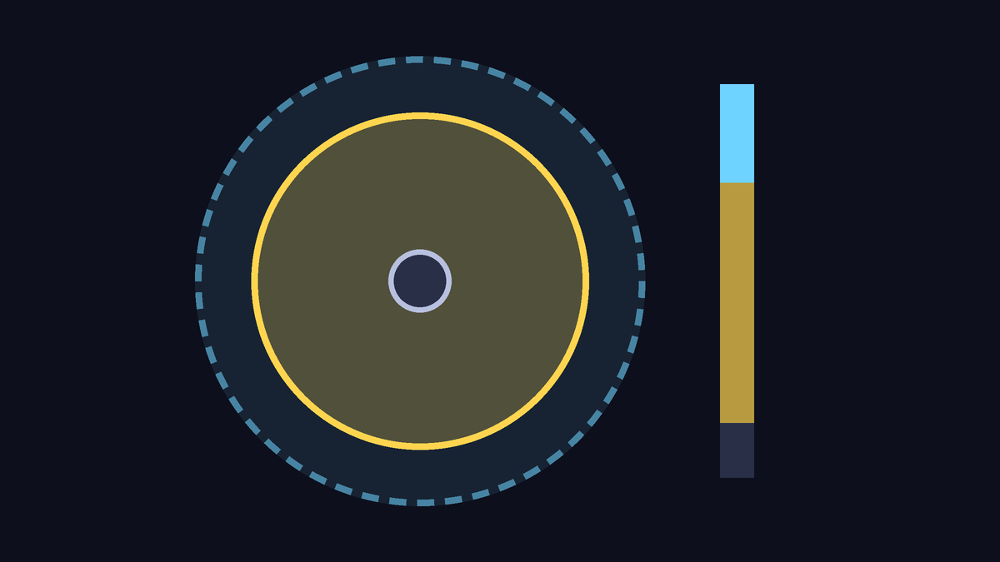
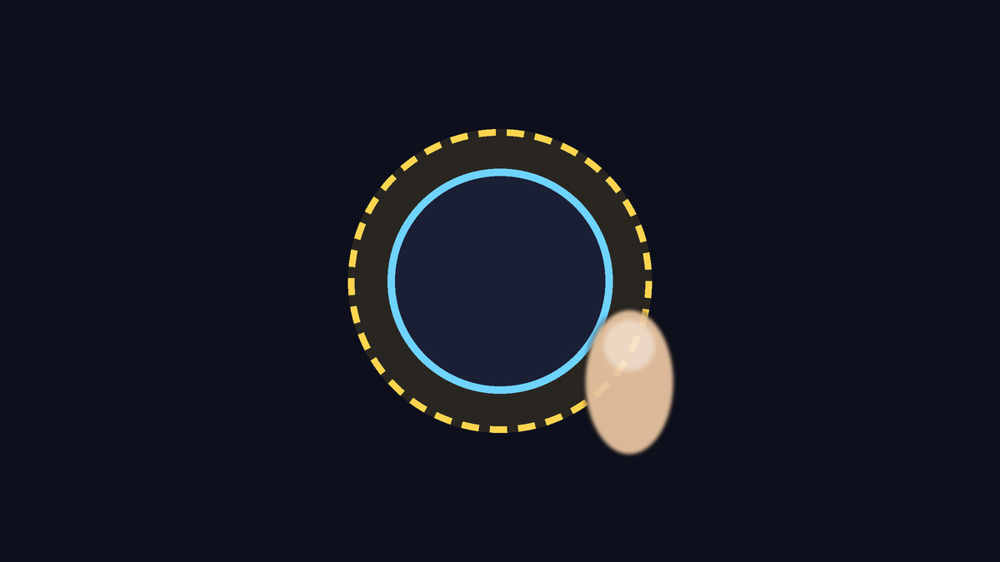
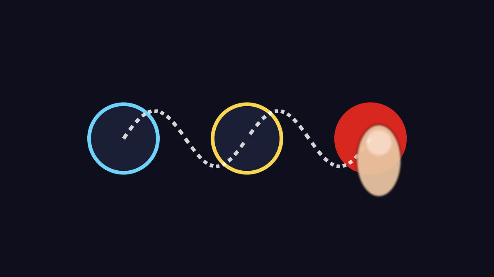
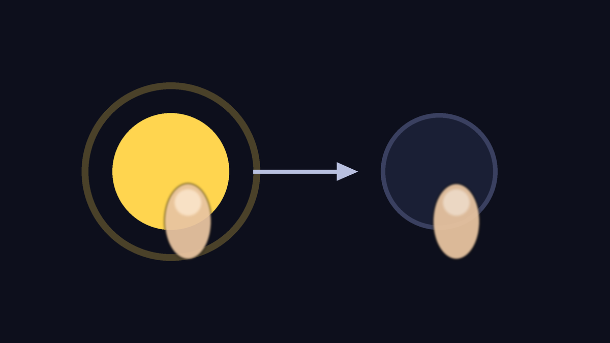
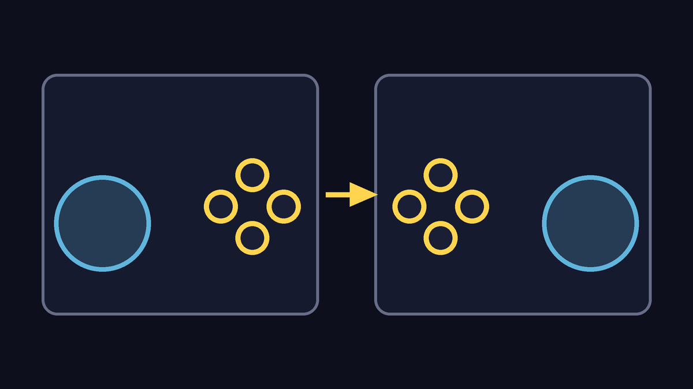

# Dragon Rage 1.0.0

**La mayor actualización hasta ahora: tres juegos en una sola app, online nuevo, el Tag Team Mod, una selección de personajes nueva
y el Toque Pro, el control en pantalla hecho para jugar de verdad sin control físico.**
Se instala encima de la 0.9.0 y de la 0.8.x, sin desinstalar: las partidas guardadas, los ajustes, los controles y los juegos
importados se mantienen.

Necesitas tu propia imagen de cada disco:
- **Budokai Tenkaichi 3**: disco americano, SLUS-21678.
- **Budokai Tenkaichi 4**: el mod del Team BT4, **Beta 14 Rev2** (SLUS-219.78).
- **Budokai Tenkaichi 2**: disco americano, SLUS-21441.

## Toque Pro: el control en pantalla rehecho
Para quien juega sin control físico, sobre todo en línea. Está en **Controles > Toque Pro**, y el botón **Cómo funciona** abre una
guía con dibujos dentro de la app.

- **Perfiles listos**: **Estándar**, **En línea competitivo** (stick más corto, botones con área más grande, Cargar Ki con un toque),
  **Relajado** (stick flotante, 8 direcciones, vibración fuerte) y **Clásico (0.9)** (como era antes). Además, **Zurdo**, que
  refleja todo el diseño.

- **Stick dinámico**: nace donde toca el pulgar. Si el pulgar pasa del borde, el centro lo acompaña: girar al otro lado es inmediato
  y nunca pierdes el stick en medio de la pelea. También hay **Fijo** y **Flotante**, y la **zona** donde nace se puede ajustar.

- **Zona muerta e inclinación total**: el pulgar quieto en el centro no hace que el luchador se deslice, y tú eliges con cuánto
  movimiento la carrera es completa. **8 direcciones** como opción, para menús y embestidas más firmes.

- **Área táctil**: cada botón acepta el toque un poco fuera de su dibujo. En un intercambio rápido, el toque que cae en el borde no se
  pierde.

- **Deslizar entre todos los botones**: desliza el pulgar de un botón a otro sin levantarlo, también los gatillos y Start. Golpe,
  ráfaga de Ki y defensa salen en un solo movimiento.

- **Toque alterna**: elige los botones que mantienes mucho tiempo (Cargar Ki, Defensa, R1, R2, L1). Un toque mantiene y el siguiente
  suelta, y el pulgar queda libre para el stick.

- **Mis perfiles**: guarda tu ajuste con un nombre (diseño, aspecto y todo lo de arriba) y cámbialo con un toque. **Vibración**
  apagada, leve o fuerte.
- Vale en los dos estilos de control en pantalla (Del juego y Clásica), en BT3, en el Tag Team y en BT2. Si ya tenías un diseño
  guardado, lo mantienes, y el stick pasa a ser el dinámico (el perfil Clásico (0.9) vuelve al comportamiento anterior).

## Selección de personajes nueva
- **Cuadrícula de luchadores, el luchador en 3D sobre un pedestal y pantalla dividida** en azul y rojo, en todos los modos de BT3 y
  del Tag Team, offline y en línea. Los cursores, las formas, los trajes y los objetos siguen siendo los del juego.
- **Nueva o Clásica, tú eliges**: la primera vez que abres el BT3 en esta versión aparecen dos tarjetas, cada una con un dibujo de cómo queda la
  pantalla. Puedes cambiarla después en Ajustes. El cambio vale la próxima vez que se abra el juego.

## Budokai Tenkaichi 2
- **Solo la ISO**: el motor viene dentro de la app, y la ISO se lee donde está, sin copiarla. Una ISO equivocada se rechaza con un
  mensaje que dice lo que se encontró.
- **BT2 en línea**: 1P VS 2P entre dos dispositivos, con una pantalla propia en el menú del juego.
- **Llenar la pantalla** (opción): el juego dibuja una vista más ancha con la forma de la pantalla, sin bordes negros. El online sigue
  en 16:9.
- **Cel shading de los personajes** activado por defecto.
- **Menos tirones en las cargas**: las texturas nuevas van todas juntas a la GPU, y el límite de memoria de las texturas sigue la RAM
  del dispositivo.
- Un error del juego aparece en la pantalla, en lugar de una pantalla negra.

## Budokai Tenkaichi 4
- **El renderizador se elige según el dispositivo**: ARMSX2 donde lo aguanta, Dragon Rage donde no lo aguanta o en el modo Lite. Si
  eliges uno en Ajustes, vale tu elección.
- **Sesiones largas**: el juego ya no crece ~7 MB de memoria por minuto (el sonido del juego creaba tareas que nunca se ejecutaban).
- **Más ligero**: se apagaron diagnósticos internos que corrían para todos los jugadores.
- **Volver a la app** ya no deja perdida la imagen de ARMSX2.
- **Escenario lejano** en el renderizador Dragon Rage: las montañas ya no salen en bloques de ruido de colores.
- **Los dispositivos débiles empiezan en 1x**: con el renderizador Dragon Rage en una GPU débil y sin resolución elegida, el juego
  dibuja en 1x y no en 2x. En un Mi A3, la pelea pasó de cerca del 20 % a cerca del 30 % de la velocidad.
- **Control en pantalla**: cambia solo entre el diseño de menú (cruceta) y el de pelea (stick), como en BT3.

## Tag Team Mod
- **Hasta 10 luchadores**, con los modos del mod de tehmufti y sus colaboradores (Batalla por equipos, Entrenamiento, Desafío, Torneo
  y más), adaptados al móvil, en un menú nuevo: el **Radar del Dragón**, con fondo nocturno y el idioma arriba.
- **Tag Team en línea**: salas por código con jugadores y espectadores. Toda la sala juega al ritmo del anfitrión; se corrigieron las
  salas que se caían, las pantallas trabadas, la desincronización del objetivo y el ms alto; la conexión se rehace sola (relay,
  IPv6). Los juegos de otra versión o con otros datos no entran en la sala. Los mensajes de la sala están en portugués y español.
- **En la pelea**: apuntar a un aliado caído ya no traba al luchador; el objetivo no se pierde; menos congelamientos; los golpes
  alcanzan a los enemigos pegados; el pelo y la sombra correctos en todas las peleas.
- **Gráficos ligeros**: opcionales, y ofrecidos una vez en los dispositivos más débiles. En un dispositivo limitado como un
  Snapdragon 480, la pelea de 5 contra 5 pasó del 73 % al 98 % de la velocidad.
- **Viene apagado**: actívalo en Ajustes. Apagado, no cambia nada en las peleas normales.

## En línea
- **Dragon Net Online**: pantallas nuevas en lugar de Dragon Net Battle, con Clasificatoria, partida rápida que prefiere jugadores
  cerca de ti, y entrada por código y por dirección.
- **Lobbies** (del PC 0.1.39): hasta 8 dispositivos, 2 juegan y hasta 6 miran. **Torneos** dentro del lobby, con cuadro de
  enfrentamientos.
- **Espectadores**: siguen el ritmo real de la partida, sin quedarse en "Waiting for the match...".
- El Wi-Fi se mantiene despierto mientras el juego está en primer plano. Pantallas en línea sin letras que desaparecen; un video que
  no abre se salta.
- Menos pedidos a los servidores, y "Servidor ocupado, inténtalo más tarde" en lugar de una falla sin explicación.
- La música aleatoria ya no separa a los dos jugadores de una partida.

## Rendimiento e imagen
- El 2D y los personajes ya no se estiran con el hilo de renderizado; las sugerencias de rendimiento de Android cubren también el
  hilo de renderizado.
- Cálculos del juego más rápidos, con el mismo resultado bit a bit (el online no cambia).
- Vulkan: SDL reaprovecha lo que ya se escribió en el mismo cuadro (menos trabajo para el driver).
- Cierre al cambiar la resolución con el movimiento suave activado: corregido.

## Controles
- El control vuelve a navegar en el launcher.
- La vibración ya no frena el juego; el control inalámbrico de Sony recibe menos comandos; el stick quieto no manda temblores.
- R1 del control táctil cambia la cámara; el mapeo del control se vuelve a leer al abrir el juego.

## Correcciones a partir de los registros de los jugadores
- Cierre al abrir los ajustes durante la pelea.
- La pantalla del juego ya no se cierra sin explicación cuando el motor no carga: aparece el error.
- Los menús y letreros ya no piden datos que ya están en la ISO.
- Aviso falso de paquete de texturas con la carpeta vacía.
- Un archivo que falla al leerse: el juego dice el motivo, lo intenta de nuevo y la pelea sigue.
- Disco modificado: un aviso claro en lugar de "sin memoria".
- `.7z` y `.rar` se rechazan con un mensaje claro. Sin internet, buscar actualizaciones ya no aparece como una falla.

## Actualización
- **Se instala encima de la 0.9.0 y de la 0.8.x.** La 0.8.1 tenía dos APK con números distintos, y quien tenía uno de ellos no podía
  instalar la 0.9.0 sin desinstalar. A partir de la 1.0, el número de cada versión sale de su nombre, y la app nunca ofrece una
  versión que Android rechazaría.
- El online pide la misma versión en los dos dispositivos.

## Problemas conocidos
- **BT4 en dispositivos débiles**: todavía lejos de la velocidad completa. En un Snapdragon 665 (Mi A3), la pelea corre a cerca del 30 % con el renderizador Dragon Rage, que la app elige sola en estos dispositivos (con ARMSX2, cerca del 20 %). El límite es el procesador, no la GPU.
- **Táctil en BT2**: el control en pantalla no cambia solo al diseño de menú, y los menús de BT2 solo leen la cruceta; en los menús,
  toca el botón ✛ de arriba (y otra vez para volver al de pelea).
- **Tag Team en línea con un dispositivo débil**: toda la sala va más lenta con él (en un 5 contra 5 con un Snapdragon 665,
  cerca del 75 %). Quien tenga un dispositivo débil debería activar los Gráficos ligeros antes de entrar.
- **Tag Team en línea**: el menú del anfitrión puede aparecer sin letras en algunos dispositivos; algunos mensajes siguen en inglés.
- **Clasificatoria**: a veces se queda en "Cargando perfil..." cuando el servidor no responde.
- **BT2 en línea** solo conecta directo o por STUN: sin relay cuando las dos redes lo bloquean.
- **Quien solo juega BT2** no recibe el aviso de actualización de la app.
- La tarjeta del online en el launcher todavía dice "Dragon Net Battle".

## Equipo y créditos
- **dfdx047**: Dragon Rage (app de Android y port).
- **Regulus CiberSec**: BT2 en Android, Dragon Net Online, Tag Team en Android y en línea, la selección de personajes nueva, lobbies
  y espectadores en Android, renderizador.
- **z3xox** y colaboradores: el port de PC (Tenkaichi3Decomp) en el que esto se basa: lobbies, torneos, espectadores, partida rápida
  por región, actualización automática.
- **Androidxxt01**: diagnóstico de lobby, código del lobby con el servidor, nuevo intento en otro servidor.
- **jllacchua**: actualizador del PC. **victorgonl**: traducción del modo historia.
- **tehmufti y los colaboradores del Tag Team Mod**: el Tag Team Mod.
- **Team BT4**: el mod Budokai Tenkaichi 4.
- Arte: **MarshallPunk** (el locutor), **pluantoine** (los botones).
- Y los proyectos en los que se apoya la app: BT3-Recomp/PS2Recomp, dbz-bt4-recomp, PCSX2/ARMSX2, BT2 Recomp, SDL3 y otros (lista
  completa en Acerca de > Licencias).
