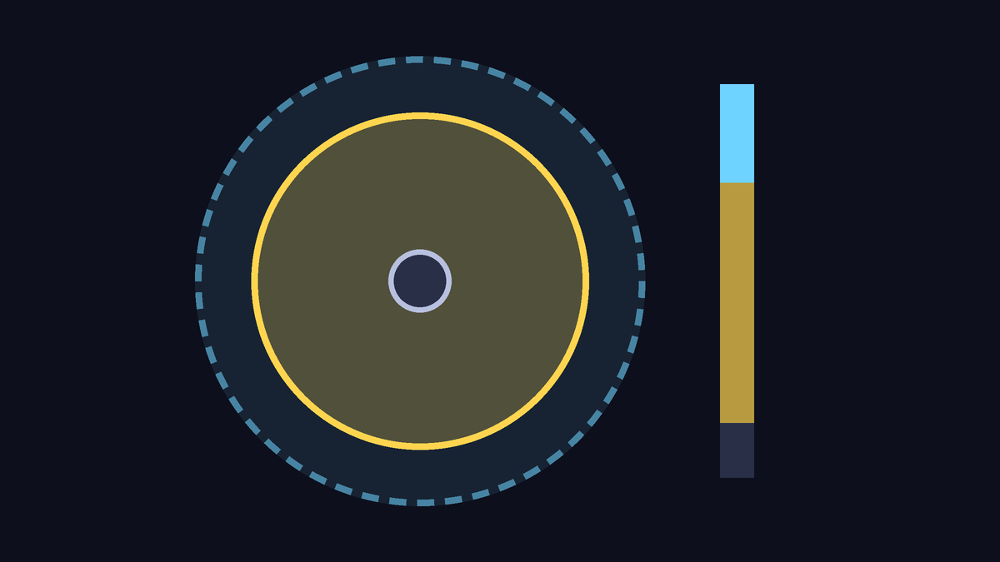
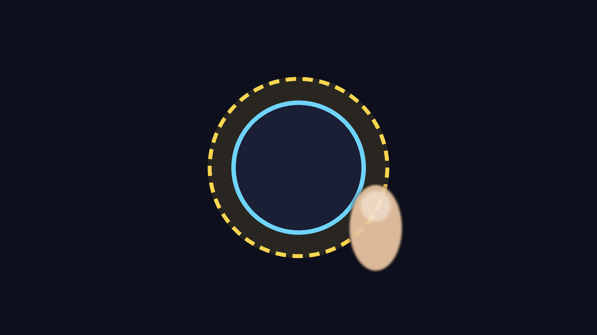
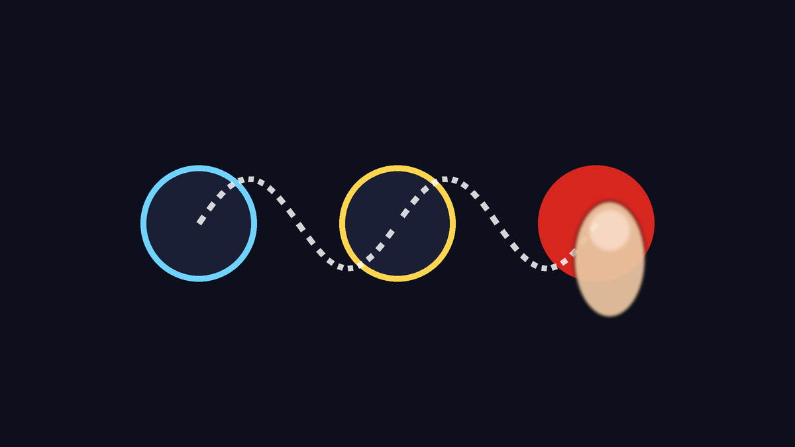
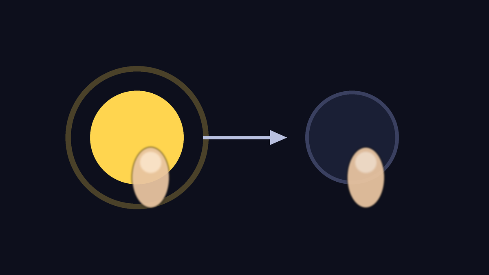
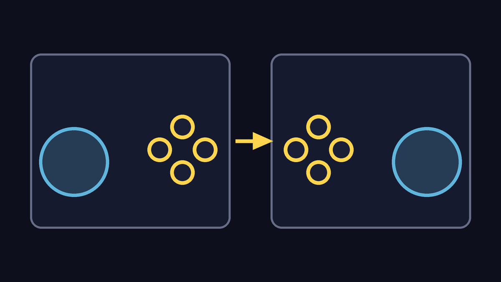

# Dragon Rage 1.0.0

**The biggest update yet: three games in one app, new online, the Tag Team Mod, a new character select and Touch Pro, the
on-screen controller made for real play without a physical controller.**
Installs over 0.9.0 and 0.8.x without uninstalling: saves, settings, controls and imported games stay.

You need your own image of each disc:
- **Budokai Tenkaichi 3**: the American disc, SLUS-21678.
- **Budokai Tenkaichi 4**: Team BT4's mod, **Beta 14 Rev2** (SLUS-219.78).
- **Budokai Tenkaichi 2**: the American disc, SLUS-21441.

## Touch Pro: the on-screen controller, remade
For anyone who plays without a physical controller, above all online. It is in **Controls > Touch Pro**, and the **How it works**
button opens a guide with drawings inside the app.

- **Ready-made profiles**: **Standard**, **Online competitive** (shorter stick travel, buttons with a bigger touch area, Ki charge
  with one tap), **Relaxed** (floating stick, 8 directions, strong vibration) and **Classic (0.9)** (as it was before). Plus
  **Left-handed**, which mirrors the whole layout.

- **Dynamic stick**: it is born where your thumb lands. If your thumb goes past the edge, the centre comes along: turning back is
  instant, and you never lose the stick in the middle of a fight. There are also **Fixed** and **Floating**, and the **Stick zone**
  where it is born can be adjusted.

- **Dead zone and full tilt**: a thumb resting in the centre does not make your fighter drift, and you choose how much movement gives
  a full run. **8 directions** as an option, for steadier menus and dashes.

- **Touch area**: each button takes a touch a little outside its drawing. In a fast exchange, a press that lands on the edge is not
  lost.

- **Slide across all buttons**: slide your thumb from one button to another without lifting it, the shoulders and Start too. Attack,
  Ki blast and guard come out in one motion.

- **Tap toggles**: choose buttons you hold for a long time (Ki charge, Guard, R1, R2, L1). One tap holds, the next lets go, and your
  thumb is free for the stick.

- **My profiles**: save your tuning under a name (layout, look and everything above) and switch with one tap. **Vibration** off,
  light or strong.
- Works with both on-screen controller styles (Game-specific and Classic), in BT3, in the Tag Team and in BT2. If you already had a
  saved layout, you keep it, and the stick becomes the dynamic one (the Classic (0.9) profile brings back the old behaviour).

## New character select
- **Roster grid, the fighter in 3D on a pedestal and a split screen** in blue and red, in every mode of BT3 and the Tag Team, offline
  and online. The cursors, forms, outfits and items are still the game's.
- **New or Classic, you choose**: the first time you open BT3 in this version, two cards appear, each with a drawing of how the screen looks. You
  can change it later in Settings. The change takes effect the next time the game opens.

## Budokai Tenkaichi 2
- **Only the ISO**: the engine comes inside the app, and the ISO is read where it is, not copied. A wrong ISO is refused with a
  message that says what was found.
- **BT2 online**: 1P VS 2P between two devices, with its own screen in the game's menu.
- **Fill the screen** (option): the game draws a wider view in the shape of your screen, with no black borders. Online stays at 16:9.
- **Cel shading on the characters**, on by default.
- **Fewer stutters while loading**: new textures go to the GPU all together, and the texture memory limit follows the device's RAM.
- A game error shows on the screen, not as a black screen.

## Budokai Tenkaichi 4
- **The renderer is chosen by device**: ARMSX2 where the device can handle it, Dragon Rage where it cannot or in Lite mode. If you
  choose one in Settings, your choice counts.
- **Long sessions**: the game no longer grows by ~7 MB of memory a minute (the game's sound created tasks that never ran).
- **Lighter**: internal diagnostics that ran for every player were turned off.
- **Going back to the app** no longer leaves the ARMSX2 picture lost.
- **Far scenery** on the Dragon Rage renderer: the mountains no longer come out as blocks of coloured noise.

## Tag Team Mod
- **Up to 10 fighters**, with the modes of the mod by tehmufti and its contributors (Team Battle, Training, Challenge, Tournament and
  more), adapted to phones, in a new menu: the **Dragon Radar**, with a night background and the language at the top.
- **Tag Team Online**: rooms by code with players and spectators. The whole room plays at the host's pace; rooms that dropped,
  stuck screens, target desync and high ms were fixed; the connection rebuilds itself (relay, IPv6). Games of another version or with
  other data cannot join the room. The room's messages are in Portuguese and Spanish.
- **In fights**: aiming at a fallen ally no longer freezes your fighter; the target is not lost; fewer freezes; attacks hit enemies
  standing close; hair and shadows right in every fight.
- **Light graphics**: optional, and offered once on the weakest devices. On a limited device like a Snapdragon 480, a 5 vs 5 fight
  went from 73% to 98% speed.
- **Off by default**: turn it on in Settings. Off, it changes nothing in normal fights.

## Online
- **Dragon Net Online**: new screens in place of Dragon Net Battle, with Ranked, a quick match that prefers players near you, and
  joining by code or by address.
- **Lobbies** (from PC 0.1.39): up to 8 devices, 2 play and up to 6 watch. **Tournaments** inside the lobby, with brackets.
- **Spectators**: they follow the match at its real pace, without stopping at "Waiting for the match...".
- Wi-Fi stays awake while the game is in front. Online screens no longer lose letters; a video that does not open is skipped.
- Fewer requests to the servers, and "Server busy, try again later" in place of an unexplained failure.
- Random music no longer sets the two players of a match apart.

## Performance and picture
- 2D and characters no longer stretch with the render thread; Android's performance hints now cover the render thread too.
- Faster game maths, with the same result bit for bit (online does not change).
- Vulkan: SDL reuses what was already written in the same frame (less work for the driver).
- Crash when changing the resolution with smooth motion on: fixed.

## Controls
- Controllers navigate the launcher again.
- Vibration no longer holds up the game; the wireless Sony controller gets fewer commands; a stick at rest sends no jitter.
- R1 on the touch controls switches the camera; the controller mapping is read again when the game opens.

## Fixes from players' logs
- Crash when opening the settings during a fight.
- The game screen no longer closes without explanation when the engine does not load: the error is shown.
- Menus and labels no longer ask for data that is already in the ISO.
- No false texture pack warning with an empty folder.
- A file that fails to read: the game says why, tries again, and the fight goes on.
- Modified disc: a clear warning in place of "out of memory".
- `.7z` and `.rar` are refused with a clear message. Without internet, checking for updates no longer shows as a failure.

## Updating
- **Installs over 0.9.0 and 0.8.x.** 0.8.1 had two APKs with different numbers, and anyone who had one of them could not install 0.9.0
  without uninstalling. From 1.0 on, each version's number comes from its name, and the app never offers a version that Android
  would refuse.
- Online needs the same version on both devices.

## Known issues
- **BT4 on weak devices**: still far from full speed. On a Snapdragon 665 (Mi A3), a fight runs at about 30 % with the Dragon Rage renderer, which the app picks by itself on these devices (with ARMSX2, about 20 %). The limit is the processor, not the GPU.
- **Touch in BT4**: the on-screen controller does not switch to the menu layout by itself; in menus, tap the ✛ button at the top to
  get the D-pad (and again to go back to the fight layout).
- **Tag Team Online with a weak device**: the whole room slows down with it (in a 5 against 5 with a Snapdragon 665, about
  75 %). Players on weak devices should turn on Light graphics before joining.
- **Tag Team Online**: the host's menu can show no letters on some devices; some messages are still in English.
- **Ranked**: sometimes stays on "Loading profile..." when the server does not answer.
- **BT2 online** only connects directly or through STUN: no relay when both networks block it.
- **Players who only play BT2** do not get the app's update notice.
- The online card in the launcher still says "Dragon Net Battle".

## Team and credits
- **dfdx047**: Dragon Rage (Android app and port).
- **Regulus CiberSec**: BT2 on Android, Dragon Net Online, Tag Team on Android and online, the new character select, lobbies and
  spectators on Android, renderer.
- **z3xox** and contributors: the PC port (Tenkaichi3Decomp) this is built on: lobbies, tournaments, spectators, quick match by
  region, automatic updates.
- **Androidxxt01**: lobby diagnostics, the lobby code with the server, retrying on another server.
- **jllacchua**: the PC updater. **victorgonl**: story mode translation.
- **tehmufti and the Tag Team Mod contributors**: the Tag Team Mod.
- **Team BT4**: the Budokai Tenkaichi 4 mod.
- Art: **MarshallPunk** (the announcer), **pluantoine** (the buttons).
- And the projects the app stands on: BT3-Recomp/PS2Recomp, dbz-bt4-recomp, PCSX2/ARMSX2, BT2 Recomp, SDL3 and others (full list
  in About > Licences).
