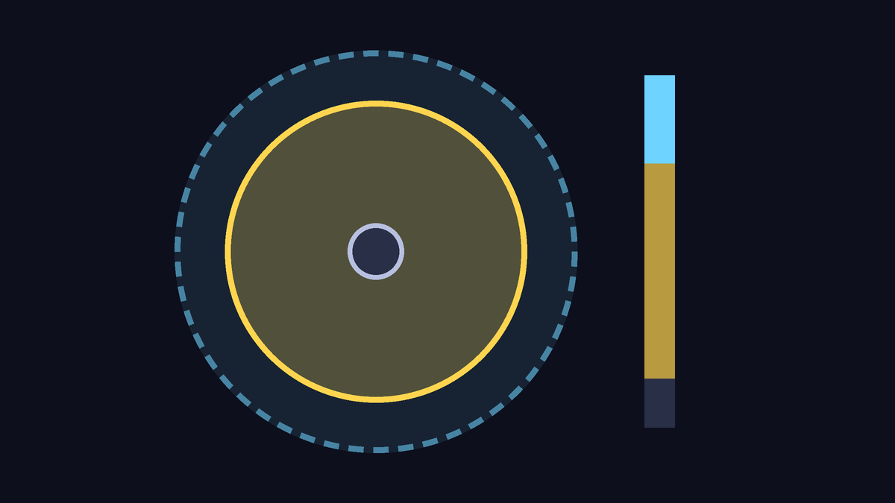
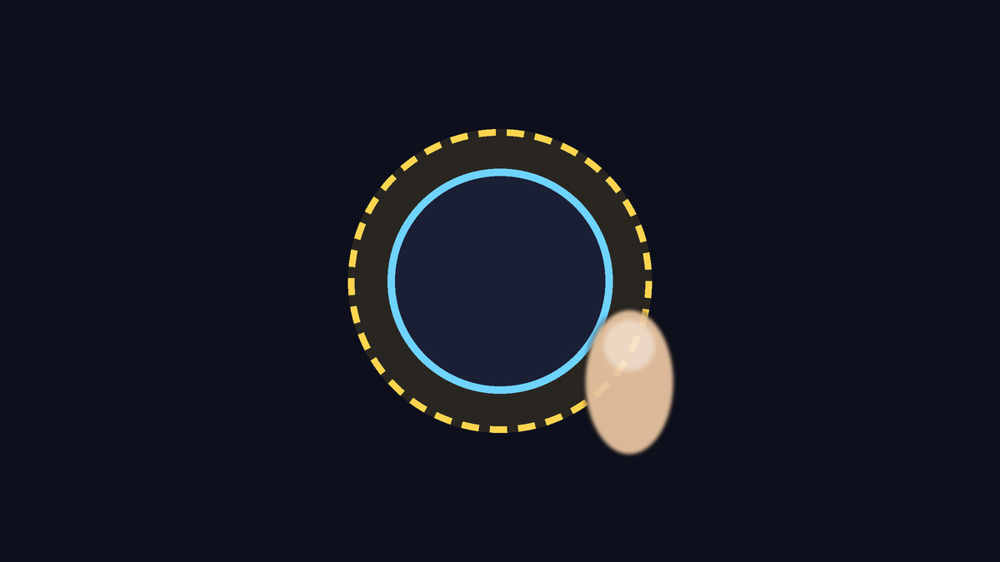
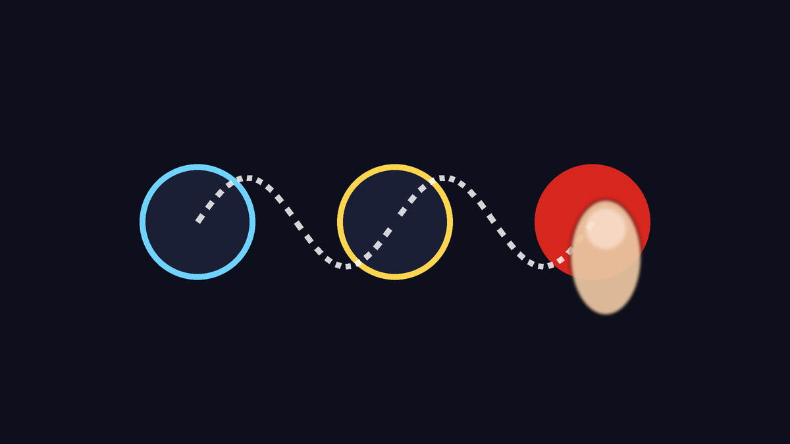
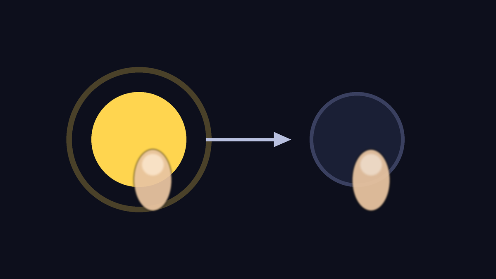
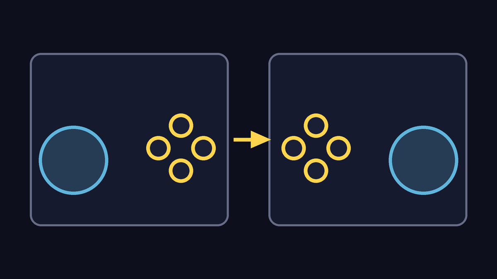

# Dragon Rage 1.0.0

**A maior atualização até agora: três jogos num app só, online novo, o Tag Team Mod, uma seleção de personagens nova e o Toque Pro,
o controle na tela feito para jogar de verdade sem controle físico.**
Instala por cima da 0.9.0 e da 0.8.x, sem desinstalar: saves, ajustes, controles e jogos importados continuam.

Você precisa da sua própria imagem de cada disco:
- **Budokai Tenkaichi 3**: disco americano, SLUS-21678.
- **Budokai Tenkaichi 4**: o mod da Team BT4, **Beta 14 Rev2** (SLUS-219.78).
- **Budokai Tenkaichi 2**: disco americano, SLUS-21441.

## Toque Pro: o controle na tela refeito
Para quem joga sem controle físico, principalmente no online. Fica em **Controles > Toque Pro**, e o botão **Como funciona** abre um
guia com desenhos dentro do app.

- **Perfis prontos**: **Padrão**, **Online competitivo** (analógico mais curto, botões com área maior, Carregar Ki num toque),
  **Tranquilo** (analógico flutuante, 8 direções, vibração forte) e **Clássico (0.9)** (como era antes). Mais o **Canhoto**, que
  espelha o layout inteiro.

- **Analógico dinâmico**: nasce onde o polegar toca. Se o polegar passa da borda, o centro vai junto: virar para o outro lado é na hora,
  e você nunca perde o analógico no meio da luta. Também há **Fixo** e **Flutuante**, e a **zona** onde ele nasce é ajustável.

- **Zona morta e inclinação total**: o polegar parado no centro não faz o lutador escorregar, e você escolhe com quanto movimento a
  corrida fica completa. **8 direções** como opção, para menus e avanços mais firmes.

- **Área de toque**: cada botão aceita o toque um pouco fora do desenho. Numa troca rápida, o toque que cai na borda não se perde.

- **Arrastar entre todos os botões**: arraste o polegar de um botão para o outro sem levantar, incluindo os ombros e o Start. Golpe,
  rajada de Ki e defesa saem num movimento só.

- **Toque alterna**: escolha botões que você segura por muito tempo (Carregar Ki, Defesa, R1, R2, L1). Um toque segura e o próximo
  solta, e o polegar fica livre para o analógico.

- **Meus perfis**: salve o seu ajuste com nome (layout, visual e tudo acima) e troque num toque. **Vibração** desligada, leve ou forte.
- Vale nos dois estilos de controle na tela (Do jogo e Clássico), no BT3, no Tag Team e no BT2. Quem já tinha um layout salvo continua
  com ele, e o analógico passa a ser o dinâmico (o perfil Clássico 0.9 volta ao comportamento antigo).

## Seleção de personagens nova
- **Grade de lutadores, o lutador em 3D num pedestal e tela dividida** em azul e vermelho, em todos os modos do BT3 e do Tag Team,
  offline e online. Os cursores, as formas, as roupas e os itens continuam os do jogo.
- **Nova ou Clássica, você escolhe**: na primeira vez que abrir o BT3 nesta versão aparecem dois cartões, cada um com um desenho de como a tela
  fica. Dá para trocar depois em Ajustes. A troca vale na próxima vez que o jogo abrir.

## Budokai Tenkaichi 2
- **Só a ISO**: o motor vem dentro do app, e a ISO é lida onde está, sem cópia. ISO errada é recusada com uma mensagem que diz o que
  foi encontrado.
- **BT2 online**: 1P VS 2P entre dois aparelhos, com tela própria no menu do jogo.
- **Preencher a tela** (opção): o jogo desenha uma visão mais larga no formato da tela, sem bordas pretas. O online continua em 16:9.
- **Cel shading dos personagens** ligado por padrão.
- **Menos engasgos nos carregamentos**: as texturas novas vão todas juntas para a GPU, e o limite de memória das texturas segue a RAM
  do aparelho.
- Um erro do jogo aparece na tela, em vez de tela preta.

## Budokai Tenkaichi 4
- **O renderizador é escolhido pelo aparelho**: ARMSX2 onde ele aguenta, Dragon Rage onde não aguenta ou no modo Lite. Se você escolher
  em Ajustes, vale a sua escolha.
- **Sessões longas**: o jogo não cresce mais ~7 MB de memória por minuto (o som do jogo criava tarefas que nunca rodavam).
- **Mais leve**: diagnósticos internos que rodavam para todo jogador foram desligados.
- **Voltar ao app** não deixa mais a tela do ARMSX2 perdida.
- **Cenário distante** no renderizador Dragon Rage: as montanhas não saem mais em blocos de ruído colorido.
- **Aparelho fraco começa em 1x**: com o renderizador Dragon Rage numa GPU fraca, sem resolução escolhida, o jogo desenha em 1x e não
  em 2x. Num Mi A3, a luta foi de cerca de 20 % para cerca de 30 % da velocidade.
- **Controle na tela**: troca sozinho entre o layout de menu (direcional) e o de luta (analógico), como no BT3.

## Tag Team Mod
- **Até 10 lutadores**, com os modos do mod de tehmufti e dos colaboradores (Batalha em Equipe, Treino, Desafio, Torneio e mais),
  adaptados para o celular, num menu novo: o **Radar do Dragão**, com fundo noturno e o idioma no topo.
- **Tag Team Online**: salas por código com jogadores e espectadores. A sala inteira joga no ritmo do anfitrião; salas que caíam,
  telas presas, dessincronia do alvo e MS alto foram corrigidos; a conexão se refaz sozinha (relay, IPv6). Jogos de outra versão ou
  com outros dados não entram na sala. As mensagens da sala estão em português e espanhol.
- **Na luta**: mirar num aliado caído não trava mais o lutador; o alvo não se perde; menos congelamentos; golpes acertam inimigos
  encostados; cabelo e sombra certos em todas as lutas.
- **Gráfico leve**: opcional, e oferecido uma vez nos aparelhos mais fracos. Num aparelho limitado como um Snapdragon 480, a luta de
  5 contra 5 foi de 73 % para 98 % da velocidade.
- **Vem desligado**: ligue em Ajustes. Desligado, ele não muda nada nas lutas normais.

## Online
- **Dragon Net Online**: telas novas no lugar do Dragon Net Battle, com Classificatória, partida rápida que prefere jogadores perto
  de você, entrada por código e por endereço.
- **Lobbies** (do PC 0.1.39): até 8 aparelhos, 2 jogam e até 6 assistem. **Torneios** dentro do lobby, com chaveamento.
- **Espectadores**: acompanham o ritmo real da partida, sem parar em "Waiting for the match...".
- O Wi-Fi fica acordado enquanto o jogo está na frente. Telas online sem letras sumindo; um vídeo que não abre é pulado.
- Menos pedidos aos servidores, e "Servidor ocupado, tente mais tarde" no lugar de uma falha sem explicação.
- A música aleatória não separa mais os dois jogadores numa partida.

## Desempenho e imagem
- 2D e personagens não esticam mais com a render thread; as dicas de desempenho do Android cobrem também a render thread.
- Contas do jogo mais rápidas, com o mesmo resultado bit a bit (o online não muda).
- Vulkan: o SDL reaproveita o que já foi escrito no mesmo quadro (menos trabalho para o driver).
- Crash ao mudar a resolução com o movimento suave ligado: corrigido.

## Controles
- O controle navega no launcher de novo.
- A vibração não segura mais o jogo; o controle Sony sem fio recebe menos comandos; analógico parado não manda tremidas.
- R1 do toque troca a câmera; o mapeamento de controle é relido ao abrir o jogo.

## Correções a partir dos logs dos jogadores
- Crash ao abrir as configurações durante a luta.
- A tela do jogo não fecha mais sem explicação quando o motor não carrega: o erro aparece.
- Menus e letreiros não pedem mais dados que já estão na ISO.
- Aviso falso de pacote de textura com a pasta vazia.
- Arquivo que falha ao ser lido: o jogo diz o motivo, tenta de novo e a luta continua.
- Disco modificado: um aviso claro no lugar de "sem memória".
- `.7z` e `.rar` são recusados com uma mensagem clara. Sem internet, buscar atualização não aparece mais como falha.

## Atualização
- **Instala por cima da 0.9.0 e da 0.8.x.** A 0.8.1 tinha dois APKs com números diferentes, e quem tinha um deles não conseguia
  instalar a 0.9.0 sem desinstalar. A partir da 1.0, o número de cada versão sai do nome, e o app nunca oferece uma versão que o
  Android recusaria.
- O online pede a mesma versão nos dois aparelhos.

## Problemas conhecidos
- **BT4 em aparelhos fracos**: ainda longe da velocidade total. Num Snapdragon 665 (Mi A3), a luta roda a cerca de 30 % com o renderizador Dragon Rage, que o app escolhe sozinho nesses aparelhos (com o ARMSX2, cerca de 20 %). O limite é o processador, não a GPU.
- **Toque no BT2**: o controle na tela não troca sozinho para o layout de menu, e os menus do BT2 só leem o direcional; nos menus,
  toque no botão ✛ do topo (e de novo para voltar ao de luta).
- **Tag Team Online com aparelho fraco**: a sala inteira fica mais lenta junto com ele (num 5 contra 5 com um Snapdragon 665,
  cerca de 75 %). Quem tem aparelho fraco deve ligar o Gráfico leve antes de entrar.
- **Tag Team Online**: o menu do anfitrião pode aparecer sem letras em alguns aparelhos; algumas mensagens ainda em inglês.
- **Classificatória**: às vezes fica em "Carregando perfil…" quando o servidor não responde.
- **BT2 online** só conecta direto ou pelo STUN: sem relay quando as duas redes bloqueiam.
- **Quem só joga BT2** não recebe o aviso de atualização do app.
- O cartão do online no launcher ainda diz "Dragon Net Battle".

## Equipe e créditos
- **dfdx047**: Dragon Rage (app Android e port).
- **Regulus CiberSec**: BT2 no Android, Dragon Net Online, Tag Team no Android e online, a seleção de personagens nova, lobbies e
  espectadores no Android, renderizador.
- **z3xox** e colaboradores: o port de PC (Tenkaichi3Decomp) em que isto se baseia: lobbies, torneios, espectadores, partida rápida
  por região, atualização automática.
- **Androidxxt01**: diagnóstico de lobby, código do lobby com o servidor, nova tentativa em outro servidor.
- **jllacchua**: atualizador do PC. **victorgonl**: tradução do modo história.
- **tehmufti e os colaboradores do Tag Team Mod**: o Tag Team Mod.
- **Team BT4**: o mod Budokai Tenkaichi 4.
- Arte: **MarshallPunk** (o locutor), **pluantoine** (os botões).
- E os projetos em que o app se apoia: BT3-Recomp/PS2Recomp, dbz-bt4-recomp, PCSX2/ARMSX2, BT2 Recomp, SDL3 e outros (lista completa
  em Sobre > Licenças).
