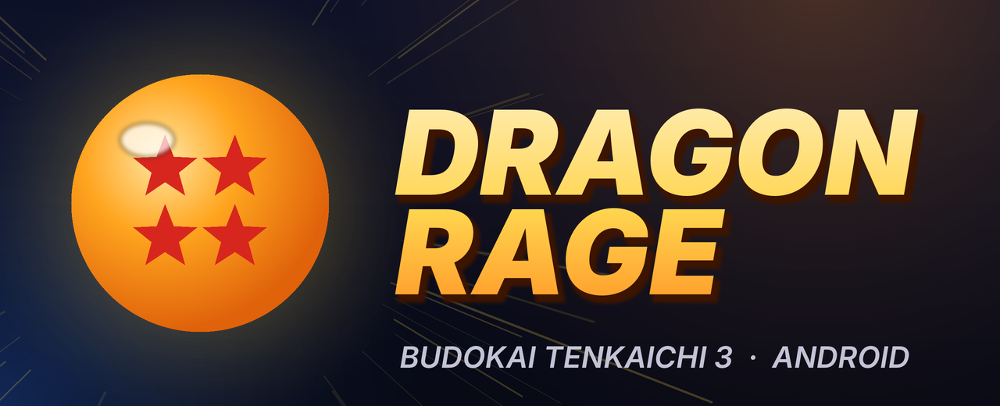
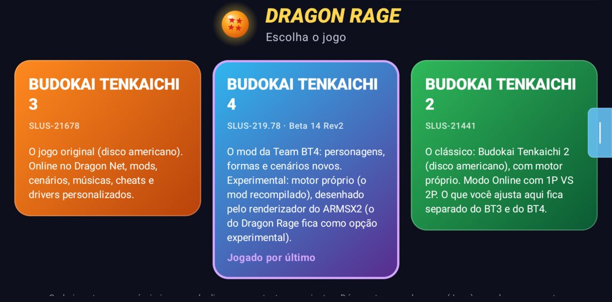
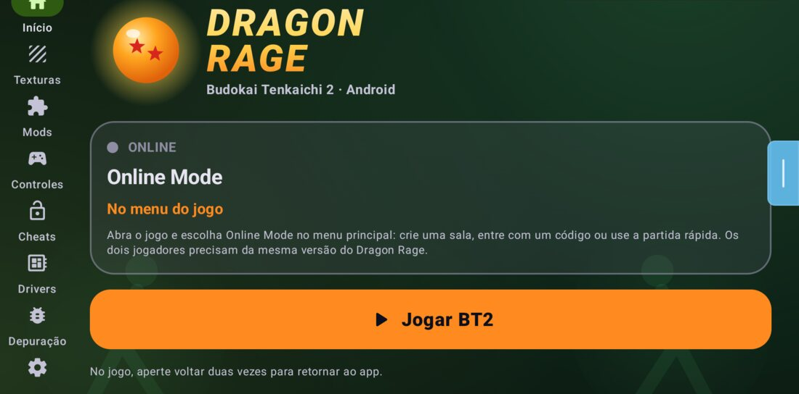
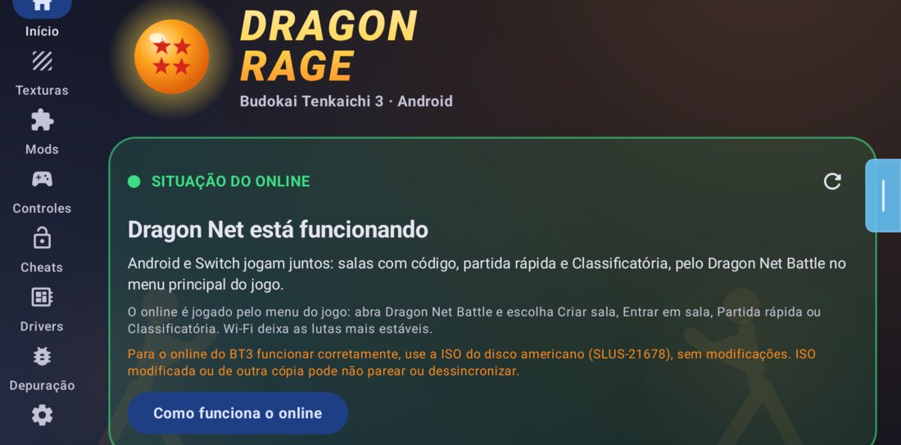
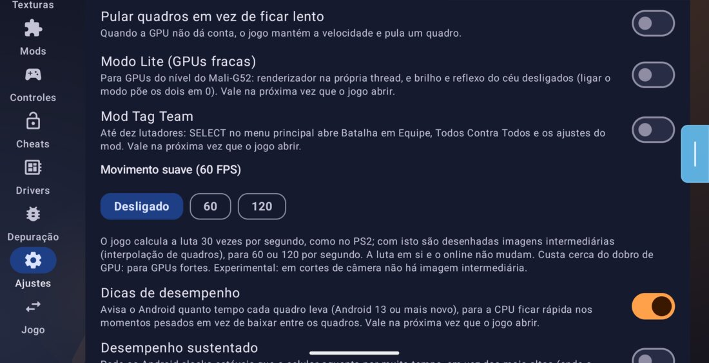
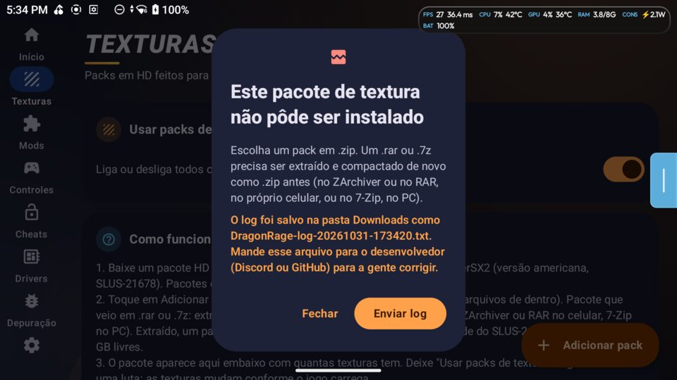
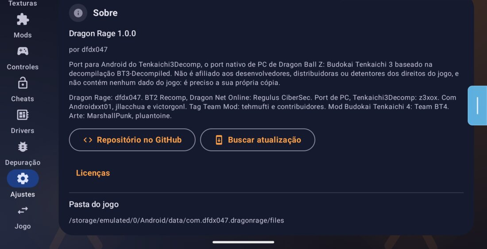
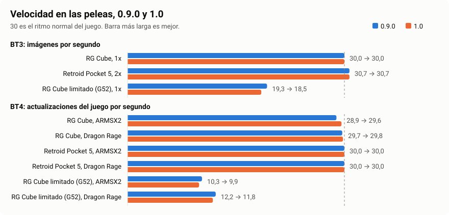
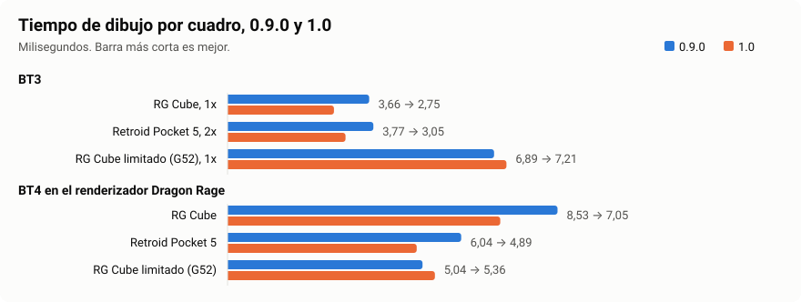

<p align="center">
  
</p>

<p align="center">
  <b>Dragon Ball Z: Budokai Tenkaichi 3, 4 y 2, corriendo de forma nativa en Android.</b><br>
  Un port para Android de <a href="https://github.com/z3xox/Tenkaichi3Decomp">Tenkaichi3Decomp</a>, el port nativo para PC construido sobre la decompilación de BT3.
</p>

<p align="center">
  <a href="README.md">English</a> · <a href="README.pt.md">Português</a> · <b>Español</b>
</p>

<p align="center">
  <a href="../../releases"></a>
  <a href="../../actions/workflows/android.yml"></a>
  
  <a href="https://discord.gg/6XXxT547Qx"></a>
  <a href="https://www.youtube.com/@DFDX47"></a>
  <a href="https://ko-fi.com/dfdx047"></a>
</p>

---

> [!IMPORTANT]
> **Estado (1.0.2): tres juegos en la misma app, nativos en Android arm64.** El **Toque Pro** rehace el control en pantalla
> para jugar sin control físico, y una **selección de personajes nueva** viene como opción. **Budokai Tenkaichi 2** ahora
> solo pide la ISO, con juego en línea entre dos aparatos. **Budokai Tenkaichi 3** gana **Dragon Net Online**, con lobbies,
> espectadores y Clasificatoria, y el **Tag Team Mod** como opción, también en línea. **Budokai Tenkaichi 4** ahora corre
> el **BT4decomp**, la decompilación de NauTaro, con la Beta 14 Rev2 en inglés o español. Se instala encima de la 1.0.x,
> de la 0.9.0 y de la 0.8.x, sin desinstalar. En inglés, portugués y español. Mira las [novedades de la
> 1.0.2](#novedades-de-la-102), las [de la 1.0](#novedades-de-la-10) y los
> [números](#números-09-y-10).

Este repositorio **no contiene ningún dato del juego**. Necesitas tu propia copia de cada juego en `.iso`: **BT3 de EE. UU.
(SLUS-21678)**, **BT2 de EE. UU. (SLUS-21441)** y **el mod BT4 de Team BT4, Beta 14 Rev2 (SLUS-219.78), en inglés o español**. La app lee el
archivo en tu dispositivo; no se descarga ni se sube nada.

## Qué es

El port para PC no es un emulador: es el propio código del juego, decompilado y compilado para PC, con una nueva capa de
renderizado, sonido y controles por debajo. Dragon Rage lleva eso a Android, junto con BT4 y BT2 recompilados:

| Parte | Dónde | Estado |
|---|---|---|
| **App launcher** (Kotlin, Jetpack Compose, Material 3; inglés, portugués y español) | [`android/`](android) | ✅ Listo |
| **Budokai Tenkaichi 3** (el código C del port, compilado para arm64 como `libbt3.so`) | `src/`, `include/`, `port/` | ✅ Corre en Snapdragon, Mali, Xclipse y PowerVR; ajustado por nivel de GPU |
| **Budokai Tenkaichi 4** (el BT4decomp, [decompilación de NauTaro](https://github.com/NauTaro/DBZ-BT4-Tag-Team-Decomp) del mod de Team BT4, como `libbt4dec.so`) | rama `bt4dec-proto` | 🧪 Experimental |
| **Budokai Tenkaichi 2** (recompilado como `libbt2.so`) | `bt2/` | ✅ Peleas, partidas guardadas y en línea |

## Novedades de la 1.0.2

- **Budokai Tenkaichi 4 con el BT4decomp**: la tarjeta del BT4 abre el [BT4decomp](https://github.com/NauTaro/DBZ-BT4-Tag-Team-Decomp), la decompilación del mod de
  Team BT4 hecha por **NauTaro** sobre Tenkaichi3Decomp, con el port Android de Dragon Rage. Reemplaza el motor anterior
  (el mod recompilado con el renderizador de ARMSX2).
- **Beta 14 Rev2 en inglés o español**. La importación copia los archivos del juego (unos 5,7 GB) y comprueba cada uno;
  después se puede borrar la ISO. Si ya tenías el BT4 en la 1.0.0 o la 1.0.1, importa la ISO otra vez (el formato cambió;
  las partidas guardadas se mantienen).
- **Ajustes del BT4** iguales a los del BT3, con el movimiento suave; se quitaron la relación de aspecto y los 60 fps del motor anterior.
- **Tag Team en el BT4**: la Local Room (contra la CPU) funciona sin red; el online depende de que Dragon Net se habilite para esta versión.
- BT3 y BT2 iguales a los de la 1.0.1. Todos los cambios: [`CHANGELOG.es.md`](CHANGELOG.es.md).

La **1.0.1** trajo el Tag Team en línea estable (sala sin caídas, revancha solo del anfitrión, menú tras la partida, lobby
nuevo), rendimiento en BT3, Tag y BT2, y la tormenta del Full Power.

## Novedades de la 1.0

<p align="center"></p>

Una app, tres juegos. Cada uno tiene su propia ISO, sus partidas guardadas, texturas y ajustes. La 1.0 se instala encima
de la 0.9.0 y de la 0.8.x, sin desinstalar: las partidas guardadas, los ajustes, los controles y los juegos importados se
mantienen.

### Toque Pro

<p align="center"></p>

El control en pantalla rehecho para jugar sin control físico, sobre todo en línea. En **Controles > Toque Pro**, con una guía
**Cómo funciona** dentro de la app.

- **Perfiles listos**: Estándar, En línea competitivo, Relajado y Clásico (0.9), además de Zurdo, que refleja el diseño.
- **Stick dinámico** (también Fijo y Flotante), **zona muerta**, **inclinación total** y **8 direcciones**.
- **Área táctil** alrededor de cada botón, **deslizar entre todos los botones**, **toque alterna** para los botones que
  mantienes, **Mis perfiles**, vibración.
- Vale en BT3, en el Tag Team y en BT2. El diseño que ya tenías guardado se mantiene.

### Selección de personajes nueva

- Cuadrícula de luchadores, el luchador en 3D sobre un pedestal y pantalla dividida en azul y rojo, en todos los modos de BT3 y
  del Tag Team, offline y en línea.
- **Nueva o Clásica**: se elige la primera vez que abres el BT3 en la 1.0, y se puede cambiar después en Ajustes.

### Budokai Tenkaichi 2 solo con la ISO

<p align="center"></p>

- **El motor viene dentro de la app.** Ya no hay paquete de motor que importar; si tenías uno, se borra después de un aviso.
- **La ISO se queda donde está**: se lee en su lugar, sin copiarla. Solo los archivos pequeños quedan en la carpeta de la app.
- **Una ISO equivocada se rechaza**, con un mensaje que dice qué se encontró y en qué pestaña se instala.
- **Online Mode en el menú del juego**: crea una sala, entra con un código o usa la partida rápida. Los dos aparatos llegan solos a la selección de personajes.

Probado entre un RG Cube y un Retroid Pocket 5: dos peleas (11.100 y 5.700 cuadros) al 100% y 30 imágenes por segundo en los dos, ninguna desincronización. Quien sale de la partida avisa al otro, que vuelve a Online Mode.

### Dragon Net Online

- **Pantallas nuevas en lugar de Dragon Net Battle**: partida rápida por región, Clasificatoria, entrada por código o dirección, perfil.
- **Lobbies de hasta ocho**: dos luchadores, seis espectadores, reglas en la página del lobby, revanchas y torneos.
- **Menos peticiones a los servidores**: nada en segundo plano, una espera creciente cuando el servidor rechaza y el mensaje "Servidor ocupado, inténtalo más tarde" en lugar de un fallo sin explicación.
- La música aleatoria ya no separa a los dos jugadores de una partida.

Probado: lobby entre los dos aparatos con ping de 10 a 14 ms y ningún rollback; 55 peleas seguidas en 580 s por conexión directa, sin ninguna desincronización. La Clasificatoria no se probó hasta el final y los espectadores necesitan un tercer aparato que no teníamos: mira los [problemas conocidos](#problemas-conocidos).

<p align="center"></p>

**Para que el online de BT3 funcione bien, usa la ISO del disco americano (SLUS-21678), sin modificar.** Una ISO modificada o de otra copia puede no emparejar o desincronizarse. La app lo avisa en la pantalla Inicio.

### Tag Team Mod

- Hasta 10 luchadores, con los modos y el Tag Team Online del mod de tehmufti y sus colaboradores, adaptados al móvil.
- **Tag Team en línea**: salas por código con jugadores y espectadores; toda la sala juega al ritmo del anfitrión.
- **Gráficos ligeros**: opcionales, ofrecidos una vez en los aparatos más débiles.
- **Viene desactivado.** Actívalo en Ajustes; después, SELECT en el menú principal abre los modos. Desactivado, no aparece en las peleas normales.

<p align="center"></p>

Probado en el Retroid Pocket 5: pelea 5 contra 5 al 100% y unas 30 imágenes por segundo. Los otros modos se abrieron, pero no se jugaron hasta el final.

### Budokai Tenkaichi 4

- **Escenario lejano corregido**: las montañas ya no salen en bloques de ruido de colores, y el desenfoque de distancia del juego funciona.
- **Renderizador por aparato**: un aparato débil o el modo Lite usa Dragon Rage; si ARMSX2 se queda por debajo de 27 actualizaciones por segundo durante 5 s en una pelea, el siguiente inicio usa Dragon Rage. Tu elección en Ajustes siempre vale.

### Correcciones a partir de los registros de los jugadores

Leímos 208 registros enviados por jugadores (485 ejecuciones, 84 modelos de aparato). Los 15 mayores problemas y el estado de cada uno están en [`docs/logs-1.0.md`](docs/logs-1.0.md).

<p align="center"></p>

- Menu font y rótulos ya no piden datos del juego que ya están en la ISO.
- Sin aviso falso de paquete de texturas con la carpeta vacía.
- Un archivo que falla al leerse: el juego dice el motivo, lo intenta de nuevo y la pelea continúa.
- Disco modificado: un tamaño negativo es un aviso claro, no "sin memoria".
- `.7z` y `.rar` se rechazan con un mensaje claro. Sin internet, buscar actualizaciones ya no aparece como fallo.
- El mando navega por el launcher de nuevo, en el RG Cube y el Retroid Pocket 5.

### Equipo y licencias en la app

<p align="center"></p>

## Números: 0.9 y 1.0

Cómo medimos: la misma pelea grabada, con las mismas entradas, en los mismos aparatos. **RG Cube** es un Mali-G57 MC4. **Retroid Pocket 5** es un Adreno 650. **RG Cube limitado** es el mismo Cube limitado a un chip como el Mali-G52 MC1 (1 núcleo de GPU a 512 MHz, solo 4 núcleos pequeños de CPU a 1,85 GHz), para imitar un móvil débil; en este perfil, 0.9.0 y 1.0 se turnaron en la misma sesión, porque el calor cambia el resultado.

<p align="center"></p>

**Budokai Tenkaichi 3** (0.9.0 → 1.0)

| Aparato y perfil | Velocidad | Imágenes/s | Trabajo por cuadro (ms) | Dibujo (ms) | Peor cuadro (ms) | Pasadas | Copias |
|---|---|---|---|---|---|---|---|
| RG Cube, 1x, Vulkan | 100% → 100% | 30,0 → 30,0 | 18,1 → 17,0 | 3,66 → 2,75 | 22,5 → 21,9 | 55,0 → 55,0 | 10,5 → 10,5 |
| Retroid Pocket 5, 2x, Vulkan | 100% → 100% | 30,7 → 30,7 | 13,8 → 13,4 | 3,77 → 3,05 | 42,8 → 11,5 | 45,4 → 45,4 | 3,7 → 3,7 |
| Retroid Pocket 5, 2x, OpenGL ES | 100% → 100% | 30,7 → 30,7 | 14,2 → 14,4 | | | | |
| RG Cube limitado, 1x | 100% → 100% | 19,3 → 18,5 | 30,9 → 31,0 | 6,89 → 7,21 | 64,1 → 83,2 | 48,5 → 49,4 | 6,6 → 7,4 |
| RG Cube limitado, 1x, Lite | 100% → 100% | 20,0 → 19,5 | 28,3 → 28,3 | 7,08 → 7,16 | | 47,9 → 46,4 | 6,5 → 6,9 |

Solo en la 1.0: RG Cube en OpenGL ES, 100%, 30,0 imágenes/s, 18,6 ms. Retroid Pocket 5 con la CPU limitada a 2 núcleos grandes y 4 pequeños, como un Snapdragon 480+ (la GPU queda entera, porque este aparato no tiene root): 100%, 30,7 imágenes/s, 14,0 ms.

**Budokai Tenkaichi 4** (0.9.0 → 1.0)

| Aparato y renderizador | Actualizaciones/s | Tiempo del juego por cuadro (ms) | Dibujo (ms) |
|---|---|---|---|
| RG Cube, ARMSX2 | 28,9 → 29,6 | 21,8 → 22,5 | |
| RG Cube, Dragon Rage | 29,7 → 29,8 | 21,7 → 21,4 | 8,53 → 7,05 |
| Retroid Pocket 5, ARMSX2 | 30,0 → 30,0 | 17,0 → 16,3 | |
| Retroid Pocket 5, Dragon Rage | 30,0 → 30,0 | 14,2 → 14,8 | 6,04 → 4,89 |
| RG Cube limitado, ARMSX2 | 10,3 → 9,9 | 61,9 → 70,5 | |
| RG Cube limitado, Dragon Rage | 12,2 → 11,8 | 55,5 → 60,2 | 5,04 → 5,36 |

Solo en la 1.0: OpenGL ES en el renderizador Dragon Rage, RG Cube 29,6 y Retroid Pocket 5 30,0 actualizaciones/s. ARMSX2 a 60 fps en el Retroid Pocket 5: 44 imágenes/s con 34,7 actualizaciones/s (experimental, vuelve a 30 donde el aparato no aguanta). Retroid Pocket 5 con la CPU limitada como arriba: 30,0 actualizaciones/s en los dos renderizadores.

<p align="center"></p>

**Budokai Tenkaichi 2** (solo en la 1.0, ya que antes pedía un paquete de motor aparte)

| Aparato | Velocidad | Imágenes/s | Cuadro típico (ms) | Cuadro más lento (ms) | Tirones |
|---|---|---|---|---|---|
| RG Cube | 100% | 30 | 33,3 | 40,8 | 0 |
| Retroid Pocket 5 | 100% | 30 | 33,3 | 35,1 | 0 |

**¿Un móvil débil gana rendimiento?** En general, no en esta versión, y preferimos decirlo. En BT3 el perfil limitado quedó igual que la 0.9.0 (de 18 a 20 imágenes por segundo en las dos, al 100% de velocidad). En BT4 el juego aún no llega a la velocidad completa en este perfil: de 8 a 10 imágenes por segundo en ARMSX2 y de 10 a 11 en Dragon Rage. El cambio útil es el valor por defecto, que ahora pasa solo al renderizador más rápido. En este perfil, dos ejecuciones de la misma versión difieren más que las dos versiones entre sí: en Dragon Rage, el tiempo del juego por cuadro fue de 53 y 58 ms en la 0.9.0 y de 53 y 68 ms en la 1.0, turnándose en la misma sesión (la tabla trae la media). La fila de ARMSX2 viene de sesiones separadas.

**¿La imagen es la misma?** Comparamos 11 cuadros fijos píxel a píxel contra la 0.9.0. En el RG Cube, ningún píxel distinto. En el Retroid Pocket 5, 5 de 10 cuadros de la demostración de apertura difieren (ver abajo).

### Problemas conocidos

- **Tag Team Online**: el menú de modos del anfitrión, después de "Listo" en la sala, sale sin letras (visto en el Retroid Pocket 5, en portugués). Quien entra por código llega a la pelea.
- **BT3 en el Retroid Pocket 5 a 2x**: 5 de 10 cuadros de la demostración de apertura difieren de la 0.9.0. Causa aún sin encontrar; en el RG Cube son 0 de 11.
- **BT2 en línea**: no hay relay en el proceso de la pelea, así que quien solo conecta por relay puede no poder jugar.
- **Desincronización en Dragon Net**: hay correcciones, pero el problema aparece en registros de varias versiones y sigue abierto.
- **Clasificatoria**: a veces se queda en "Cargando perfil..." cuando el servidor no responde.
- **Quien solo juega BT2** no recibe el aviso de actualización de la app.
- La tarjeta del online en el launcher todavía dice "Dragon Net Battle".
- **BT4 (BT4decomp)**: el Tag Team en línea depende de que Dragon Net se habilite para la 1.0.2; la Local Room funciona.
- **Aún sin probar**: importación limpia de BT3 y BT4 en esta versión, Clasificatoria hasta el final, espectadores, Tag Team Online en todos los modos, el modo contra PC.

## La app

<table>
<tr><td><b>Inicio</b></td><td>Elige tu ISO. La app comprueba que sea la versión de EE. UU. (las mismas verificaciones SHA-1 que la instalación de PC; una imagen traducida o modificada también se instala, con una advertencia) y copia los datos del juego con la estructura que espera el motor. El botón <b>Jugar</b>, un <b>acceso directo para Jugar</b> en la pantalla de inicio, <b>cómo funciona el online</b> (y qué hacer cuando no conecta) y enlaces a YouTube, Discord, Ko-fi y GitHub.</td></tr>
<tr><td><b>Texturas</b></td><td>Importa un pack de texturas en <code>.zip</code>, descarga uno desde la propia app (de una lista mantenida en <a href="android/texture-packs.json"><code>android/texture-packs.json</code></a>, o de cualquier enlace directo a un <code>.zip</code>), o copia su carpeta en <code>textures/</code>. Los packs hechos para PCSX2 (<code>.dds</code> / <code>.png</code>) funcionan tal cual: los archivos <code>.dds</code> se descomprimen para las GPUs de los teléfonos, que no pueden leer DXT.</td></tr>
<tr><td><b>Mods</b></td><td>Mods de reemplazo de archivos en <code>.zip</code> (con orden de prioridad), escenarios extra (<code>.unk</code>) y canciones extra (<code>.adx</code>, o <code>.mp3</code>: las convierte el juego), con el nombre que aparece en los menús del juego editable.</td></tr>
<tr><td><b>Controles</b></td><td>El control en pantalla: el estilo <b>Dragón</b> (nuevo por defecto: botones redondos oscuros con iconos dorados, letras con los colores de Xbox, una Esfera del Dragón de tres estrellas como stick), el estilo <b>Cristal</b> de la 0.5 o el mando <b>clásico</b> de consola; una distribución hecha para este juego que cambia <b>sola</b> entre menús y peleas (modo historia incluido), letras de PlayStation, Xbox o Nintendo, editor de distribución, macros, opacidad, tamaño, vibración, un solo botón en los choques; <b>Toque Pro</b>: stick dinámico, zona muerta, área táctil, deslizar, toque alterna, perfiles y una guía.</td></tr>
<tr><td><b>Trucos</b></td><td><i>Desbloquear todo</i>: todos los personajes, escenarios, canciones y objetos, y Zeni al máximo (la función de depuración que los desarrolladores dejaron en el juego).</td></tr>
<tr><td><b>Drivers</b></td><td>Drivers Vulkan personalizados para GPUs Adreno (Snapdragon) mediante AdrenoTools: las últimas versiones de <b>Mr. Purple</b>, <b>StevenMXZ</b> y <b>K11MCH1</b> descargadas e instaladas con un toque, un <code>.zip</code> desde tus archivos, elegir, eliminar.</td></tr>
<tr><td><b>Depuración</b></td><td>Tu dispositivo y tu GPU con su <b>nivel</b>, los ajustes recomendados para ella, el <b>log de rendimiento</b> de la última sesión (velocidad en peleas y menús, cuadros por segundo; activado por defecto, sin un costo que se note) y <i>Guardar log en Descargas</i> para reportar bugs.</td></tr>
<tr><td><b>Ajustes</b></td><td>Renderizador (<b>Vulkan</b>, u <b>OpenGL ES</b> para drivers en los que Vulkan falla), resolución interna de 1x a 8x en pasos finos, filtro de pantalla (bilineal, nítido, FXAA, AMD FSR 1, Snapdragon GSR), formato de imagen, <b>orientación de pantalla</b> (horizontal, vertical, automática), <b>profundidad precisa</b>, <b>saltar cuadros</b> en vez de ir lento, movimiento suave (60 / 120), modo de presentación, los efectos de PS2, volúmenes, idioma, tema, Material You, la <b>selección de personajes</b> (Nueva o Clásica), el <b>Mod Tag Team</b>.</td></tr>
<tr><td><b>En el juego</b></td><td>Un nuevo menú hecho para dedos y mandos, con el estilo del launcher y en tu idioma: Video, Rendimiento, Efectos, Audio, Interfaz (fuentes, HUD, barras laterales), Controles, <b>Online</b> (cómo funciona, qué hacer cuando falla), Trucos, <b>Salir a la app</b>. Botón Atrás, START + SELECT o el botón MENU en pantalla.</td></tr>
</table>

<p align="center"></p>

### Tu GPU, a 30 fps

La primera vez que se abre con una GPU conocida, la app te dice cuál encontró y te ofrece los ajustes de ese nivel
(ves la lista y dices que sí o que ahora no; todo se puede seguir cambiando):

| Nivel | GPUs (ejemplos) | Ajustes ofrecidos |
|---|---|---|
| Básica | Mali-G31/G51/G52/G57, Mali-T, Adreno 3xx–5xx y 610/612, PowerVR GE/GM | 1x, movimiento suave desactivado, profundidad precisa desactivada, saltar cuadros, ambos desenfoques desactivados |
| Débil | Mali-G68/G71/G72, Adreno 613–620 y 702–712, Xclipse 530/540, PowerVR BXM | 1x, movimiento suave desactivado, profundidad precisa desactivada, saltar cuadros, desenfoque de movimiento desactivado |
| Intermedia | Mali-G76/G77/G78/G610/G615, Adreno 630–644 y serie 720, Maleoon | 1.5x, movimiento suave desactivado, profundidad precisa desactivada |
| Potente | Mali-G710/G715/G720/G725, Adreno 650–699 y serie 730, Xclipse 920 | 2x |
| Gama alta | Adreno 740 y más nuevas (8 Gen 2, 8 Gen 3, 8 Elite), Immortalis, Mali-G925, Xclipse 940+ | 2x, movimiento suave 60 |

### Instalación

Descarga `DragonRage-<version>.apk` desde la [última versión](../../releases/latest) e instálalo. Una versión nueva
se instala encima de la anterior y conserva tus datos del juego, ajustes y partidas guardadas; la 1.0.2 se instala
encima de la 1.0.x, de la 0.9.0 y de la 0.8.x, sin desinstalar. La app revisa GitHub al abrirse y te ofrece las versiones nuevas con su
changelog.

Para reportar un problema: *Depuración → Guardar log en Descargas*, y luego envía el archivo `DragonRage-log-….txt` (en [Discord](https://discord.gg/6XXxT547Qx), por ejemplo).

Para compilarlo tú mismo:

```sh
sh port/tools/android_toolchain.sh   # LLVM 21, the NDK's sysroot, SDL3 (once)
python3 port/tools/android.py        # the engine -> android/app/src/main/jniLibs (and its fonts and pictures -> assets)
sh .github/bt4dec-engine.sh            # BT4 (BT4decomp): libbt4dec.so and libdatachannel.so from the draft release bt4dec-engine
                                       # (built from the branch bt4dec-proto with blank data tables: no game data)
python3 bt2/android/build.py         # BT2, from your own disc (only with its files on this PC; nothing goes to git)
cd android && ./gradlew assembleRelease   # needs JDK 17+ and the Android SDK (compileSdk 35)
```

La biblioteca de BT2 se hace a partir del programa del juego: solo va dentro del APK compilado en tu PC, nunca al git. El
BT4decomp no lleva datos del juego: sus tablas van en blanco y se leen de tu ISO al importar.

### Dónde van los archivos

Todo vive en `Android/data/com.dfdx047.dragonrage/files/`, con **la misma estructura que usa el port para PC junto a
su ejecutable**:

```
gamedata/            the disc's files (disc/SLUS_216.78, disc/BIN/, disc/DATA/ with the AFS archives, .installed)
gamedata/mods/       replaced files (rebuilt by the app from modlib/)
textures/            active texture packs (any depth)      textures_off/   packs switched off
stages/  songs/      extra stages and songs (maps.txt / songs.txt hold the menu names)
saves/               memory card
fonts/  tbo/ui/      the menu fonts and the online screens' pictures (copied from the app)
bt3_settings.txt     engine settings (name=number lines)
bt3_log.txt          the game's log of its last run
modlib/              the app's mod library
```

Claves de Android en `bt3_settings.txt`: `dr_unlock_all`, `dr_renderer` (0 automático, 1 Vulkan, 2 OpenGL ES), `dr_orient`
(0 horizontal, 1 vertical, 2 automática), `dr_lang` (el idioma del menú dentro del juego), `dr_gpu_tier` (el nivel cuyos
ajustes se ofrecieron), `perf_log`, `frag_depth`. El control en pantalla está en `touch_controls.json`. Un archivo
opcional `match_url.txt` (una línea, `https://...`) indica otro servicio de matchmaking.

## Hoja de ruta

### Listo
- [x] Launcher: instalación desde la ISO con checksums, packs de texturas, mods, escenarios y canciones extra, trucos,
      todos los ajustes del motor, inglés / portugués / español
- [x] Motor para arm64, cargado en cualquier parte de los 4 GB bajos; el juego completo a toda velocidad en Snapdragon y
      Mali recientes
- [x] Táctil: un control hecho para este juego con distribución automática de menú / pelea, editor de distribución,
      macros, tres estilos (0.3–0.6)
- [x] Mali y GPUs débiles: Vulkan sin las funciones opcionales que le faltan a Mali, shaders sin `discard`, render
      targets pequeños; renderizador OpenGL ES 3.2 con un anillo de uniform buffers (0.5–0.6)
- [x] Juego online con códigos de sala y rollback, PC y Android juntos (0.4)
- [x] Packs de texturas HD (`.dds` descomprimidos en la CPU), un límite de memoria para la caché (0.5)
- [x] **0.6.0**: lo último del port para PC (pantallas de Tenkaichi Budokai Online, fuentes de menú y de combate, paneles
      de luchadores en los laterales, profundidad precisa, sombras planas con stencil, canciones en MP3, Pelear de nuevo
      en el modo historia), un nuevo menú dentro del juego para pantallas táctiles, niveles de GPU con ajustes
      recomendados, descarga de drivers, página de Depuración, orientación, español, el control Dragón, la distribución
      automática del modo historia corregida
- [x] **0.7.0**: la 0.1.36 del port de PC (online aceptado de nuevo), aviso del estado del online en el launcher,
      página Dragon Net Battle táctil, packs de texturas guardados en ASTC, comprobación de ISOs modificadas o incompletas y un aviso que explica por qué se
      cerró el juego
- [x] **0.7.1**: framebuffer fetch desactivado de nuevo (bloques negros y GPU congelada en Mali-G52 con OpenGL ES),
      aviso al elegir OpenGL ES en una Mali
- [x] **0.7.2**: packs de texturas en ASTC desactivados por defecto (experimental): las peleas vuelven al código de
      motor de la 0.6.0
- [x] **0.7.3**: la 0.1.37 del port de PC (online aceptado de nuevo, mensajes al empezar la partida, blending de la
      Solar Flare, catálogos de texto)
- [x] **0.8.0**: **Dragon Net**: online con el port de Nintendo Switch (DBT-NX) en un servicio propio (salas, partida
      rápida, Clasificatoria con Elo, chat general, jugadores en línea), sin depender de las versiones del port de PC;
      nueva pantalla Dragon Net Battle; online contra PC como opción (`port/dragonnet`, `docs/DRAGON_NET.md`)
- [x] **0.8.1**: Dragon Net en tres servidores (uno de reserva y la Clasificatoria aparte), menos peticiones a ellos
- [x] **0.9.0**: la 0.1.38.7 del port de PC; Budokai Tenkaichi 4 con el renderizador de ARMSX2 por defecto (shaders
      compilados de antemano), peleas a 60 fps (experimental, vuelve a 30 donde el dispositivo no las aguanta); el
      online se pausa con el HTTP 429 y avisa que el servidor está ocupado; el control clásico cabe en pantallas
      cuadradas; medida en un RG Cube y un Retroid Pocket 5 (`docs/release-0.9.0.md`)
- [x] **1.0.0**: Toque Pro; la selección de personajes nueva (Nueva o Clásica); BT2 solo con la ISO y BT2 en línea; Dragon
      Net Online con lobbies, espectadores y Clasificatoria (PC 0.1.39); Tag Team Mod como opción, con Tag Team en línea; se
      instala encima de la 0.9.0 y de la 0.8.x; escenario lejano de BT4 corregido y renderizador por aparato; correcciones a partir de 208 registros
      de jugadores; menos peticiones a los servidores; equipo y licencias en la app; mapa de cambios en `docs/changes/`
      (`docs/release-1.0.md`, en portugués)
- [x] **1.0.1**: Tag Team en línea estable (sala sin caídas, revancha solo del anfitrión, menú tras la partida, lobby
      nuevo); rendimiento en BT3, Tag y BT2; tormenta del Full Power; menos peticiones a Dragon Net
- [x] **1.0.2**: Budokai Tenkaichi 4 con el BT4decomp (NauTaro), Beta 14 Rev2 en inglés o español, importación comprobada
      archivo por archivo, ajustes del BT3 en el BT4

### Lo que viene
- [ ] Más GPUs medidas para los niveles (¡envía tu log!)
- [ ] Imagen: filtrado anisotrópico, SMAA, más posprocesado
- [ ] Pausar el juego mientras la app está en segundo plano

## Estructura del repositorio

| Ruta | Contenido |
|---|---|
| `android/` | **Dragon Rage**, la app de Android (proyecto Gradle) |
| `src/`, `include/` | El código del juego, sacado de la decompilación; los cambios de PC están dentro de `#ifdef PORT` |
| `port/` | El port para PC: capa de plataforma, renderizador, sonido, controles, herramientas de compilación |
| `bt2/` | Budokai Tenkaichi 2 recompilado: runtime, plugin en línea, compilación para Android |
| `port/bt4/` | El motor anterior de Budokai Tenkaichi 4 (hasta la 1.0.1): ganchos, shim y compilación. El BT4decomp está en la rama `bt4dec-proto` |
| `docs/` | Notas sobre el juego y sobre el port para PC; [`docs/changes/`](docs/changes) es el mapa de lo que cambió, por área y por archivo |

## Equipo y créditos

- **[Tenkaichi3Decomp](https://github.com/z3xox/Tenkaichi3Decomp)**, de **z3xox** y colaboradores: el port nativo de PC
  en el que se basa esto, y la decompilación debajo de él.
- **Dragon Rage** (app Android y port): [dfdx047](https://github.com/dfdx047) ·
  [YouTube](https://www.youtube.com/@DFDX47) · [Discord](https://discord.gg/6XXxT547Qx) · [Ko-fi](https://ko-fi.com/dfdx047)
- **Regulus CiberSec**: BT2 Recomp en Android, Dragon Net Online, Tag Team en Android y en línea, la selección de personajes
  nueva, espectadores y lobbies.
- **Androidxxt01**, **jllacchua**, **victorgonl**: contribuciones al port de PC y a la app.
- **tehmufti y los colaboradores de Tag Team Mod**: el Tag Team Mod.
- **Team BT4**: el mod Budokai Tenkaichi 4.
- **[NauTaro](https://github.com/NauTaro/DBZ-BT4-Tag-Team-Decomp)**: el BT4decomp, la decompilación del mod BT4 que corre en la tarjeta del BT4.
- Arte: **MarshallPunk** (el locutor), **pluantoine** (los botones, CC BY 4.0).
- Drivers de GPU de [Mr. Purple](https://github.com/MrPurple666/purple-turnip), [StevenMXZ](https://github.com/StevenMXZ/Adreno-Tools-Drivers)
  y [K11MCH1](https://github.com/K11MCH1/AdrenoToolsDrivers), cargados con [libadrenotools](https://github.com/bylaws/libadrenotools) (BSD-2-Clause).
- [AMD FidelityFX Super Resolution 1](https://github.com/GPUOpen-Effects/FidelityFX-FSR) (MIT),
  [Snapdragon Game Super Resolution](https://github.com/SnapdragonStudios/snapdragon-gsr) (BSD-3-Clause), [SDL3](https://libsdl.org) (zlib), [Apache Commons Compress](https://commons.apache.org/proper/commons-compress/) (Apache-2.0),
  [Dear ImGui](https://github.com/ocornut/imgui) (MIT), las fuentes en `port/third_party/fonts` (cada una con su licencia).
- Hecho con ayuda de IA.

## Licencia

El código propio del port para PC (`port/`, excepto `port/third_party/`) está bajo la [GNU Affero General Public License,
versión 3](LICENSE) a partir del commit `06e4671` del port para PC (2026-10-14); el código anterior sigue disponible
bajo la [licencia MIT](LICENSE-MIT). Dragon Rage se construye sobre ese código, así que la app en su conjunto se
distribuye bajo la AGPL-3.0, con su código fuente completo aquí; los archivos propios de la app de Android (`android/`)
también se ofrecen bajo MIT. Las bibliotecas en `port/third_party/` y los shaders de FSR / GSR mantienen sus propias
licencias (en los archivos que los acompañan). El código del juego en `src/` e `include/` viene de la decompilación y
pertenece a los titulares de los derechos del juego.

## Aviso legal

Este proyecto no está afiliado ni respaldado por los desarrolladores, distribuidores ni titulares de los derechos del
juego. Existe con fines de preservación, estudio e interoperabilidad, y no distribuye ningún recurso del juego. Dragon
Ball y todos los nombres relacionados pertenecen a sus dueños. Necesitas tu propia copia del juego, obtenida legalmente.
