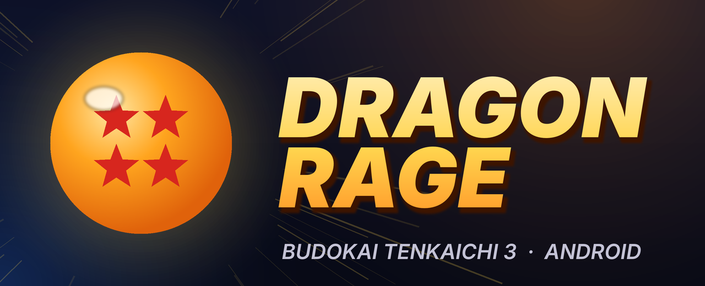
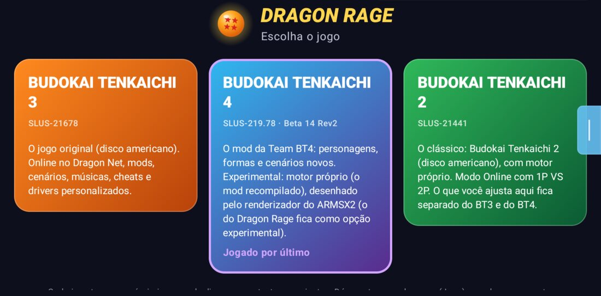
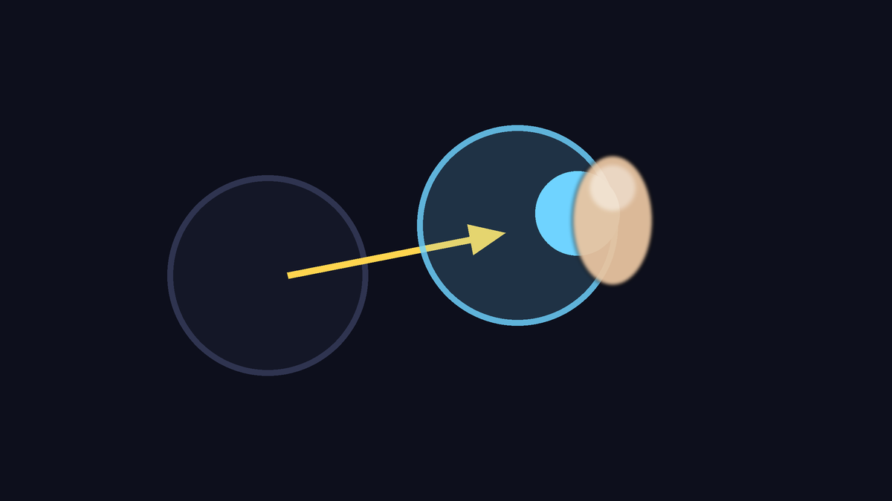
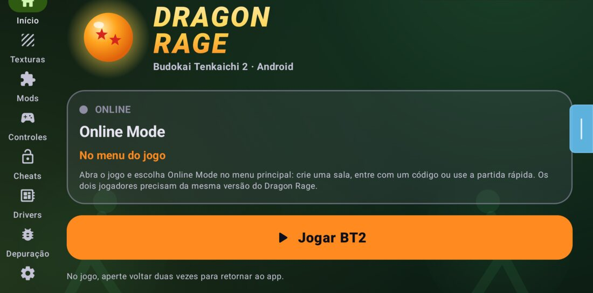
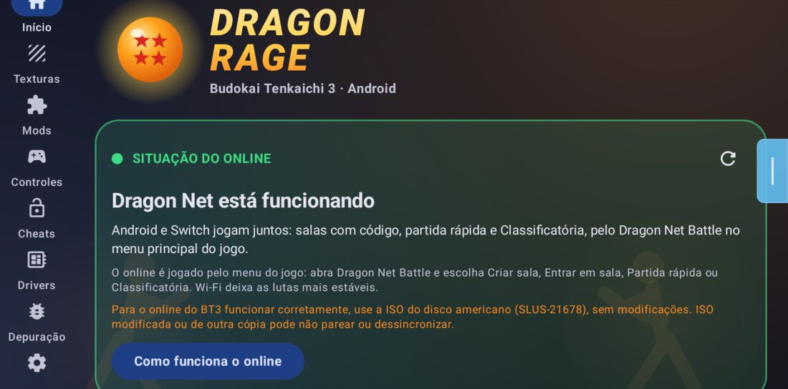
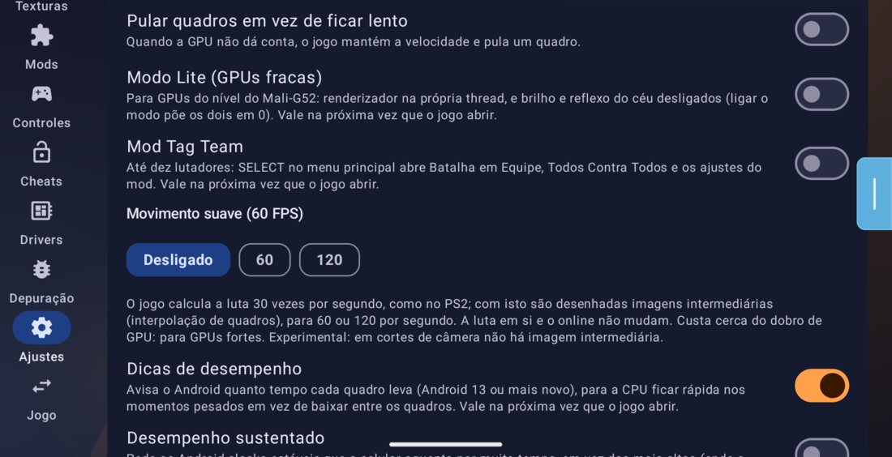
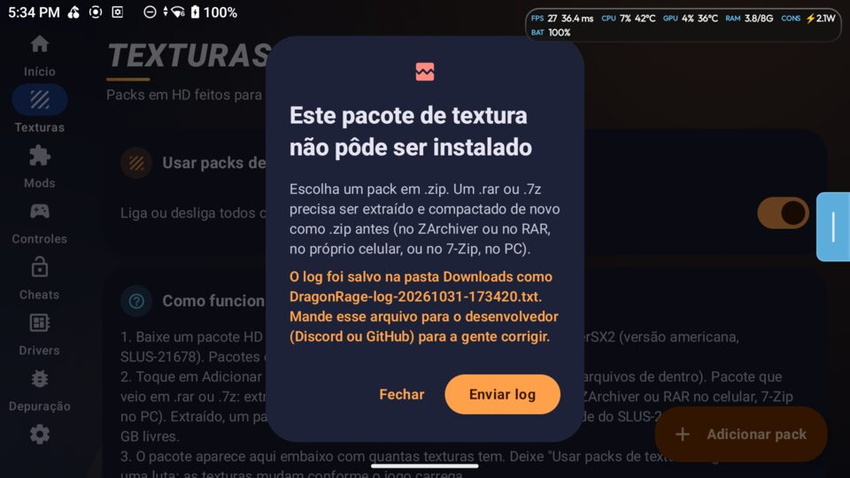
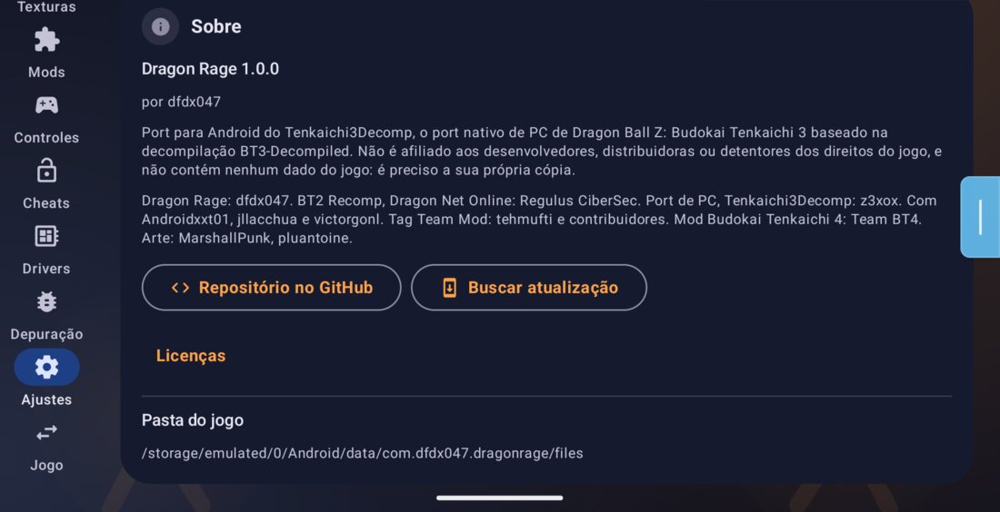
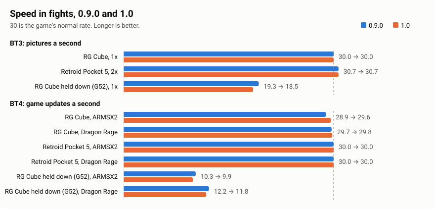
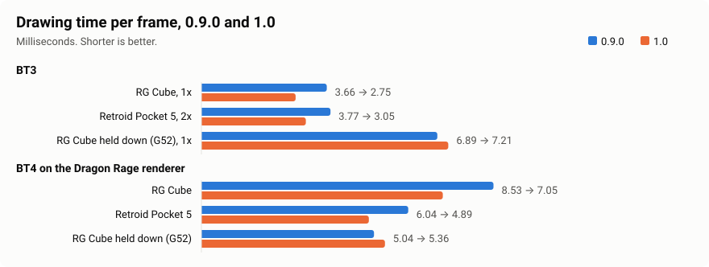

<p align="center">
  
</p>

<p align="center">
  <b>Dragon Ball Z: Budokai Tenkaichi 3, 4 and 2, running natively on Android.</b><br>
  An Android port of <a href="https://github.com/z3xox/Tenkaichi3Decomp">Tenkaichi3Decomp</a>, the native PC port built on the BT3 decompilation.
</p>

<p align="center">
  <b>English</b> · <a href="README.pt.md">Português</a> · <a href="README.es.md">Español</a>
</p>

<p align="center">
  <a href="../../releases"></a>
  <a href="../../actions/workflows/android.yml"></a>
  
  <a href="https://discord.gg/6XXxT547Qx"></a>
  <a href="https://www.youtube.com/@DFDX47"></a>
  <a href="https://ko-fi.com/dfdx047"></a>
</p>

---

> [!IMPORTANT]
> **Status (1.0.0): three games in one app, native on Android arm64.** **Touch Pro** remakes the on-screen controller for
> playing without a physical controller, and a **new character select** comes as an option. **Budokai Tenkaichi 2** now needs
> only the ISO, with online play between two devices. **Budokai Tenkaichi 3** gets **Dragon Net Online**, with lobbies,
> spectators and Ranked, and the **Tag Team Mod** as an option, online too. **Budokai Tenkaichi 4** has its far scenery fixed
> on the Dragon Rage renderer and picks the renderer by device. Installs over 0.9.0 and 0.8.x without uninstalling. English,
> Portuguese and Spanish. See [what's new](#whats-new-in-10) and the [numbers](#numbers-09-and-10).

This repository contains **no game data**. You need your own copy of each game as an `.iso`: **USA BT3 (SLUS-21678)**,
**USA BT2 (SLUS-21441)** and **Team BT4's BT4 mod, Beta 14 Rev2 (SLUS-219.78)**. The app reads the file on your device;
nothing is downloaded or uploaded.

## What it is

The PC port is not an emulator: it is the game's own code, decompiled and compiled for PC, with a new renderer,
sound and input layer underneath. Dragon Rage brings that to Android, together with the recompiled BT4 and BT2:

| Part | Where | State |
|---|---|---|
| **Launcher app** (Kotlin, Jetpack Compose, Material 3; English, Portuguese and Spanish) | [`android/`](android) | ✅ Done |
| **Budokai Tenkaichi 3** (the port's C code, built for arm64 as `libbt3.so`) | `src/`, `include/`, `port/` | ✅ Runs on Snapdragon, Mali, Xclipse and PowerVR; tuned per GPU tier |
| **Budokai Tenkaichi 4** (Team BT4's mod, recompiled as `libbt4.so`; ARMSX2's renderer in `libbt4gsx.so`, or Dragon Rage's) | `port/bt4/` | 🧪 Experimental |
| **Budokai Tenkaichi 2** (recompiled as `libbt2.so`) | `bt2/` | ✅ Fights, saves and online |

## What's new in 1.0

<p align="center"></p>

One app, three games. Each has its own ISO, saves, textures and settings. 1.0 installs over 0.9.0 and 0.8.x without
uninstalling: saves, settings, controls and imported games stay.

### Touch Pro

<p align="center"></p>

The on-screen controller, remade for playing without a physical controller, above all online. In **Controls > Touch Pro**, with
a **How it works** guide inside the app.

- **Ready-made profiles**: Standard, Online competitive, Relaxed and Classic (0.9), plus Left-handed, which mirrors the layout.
- **Dynamic stick** (also Fixed and Floating), **dead zone**, **full tilt** and **8 directions**.
- **Touch area** around each button, **slide across all buttons**, **tap toggles** for buttons you hold, **My profiles**, vibration.
- Works in BT3, the Tag Team and BT2. A layout you already saved is kept.

### New character select

- A roster grid, the fighter in 3D on a pedestal and a split screen in blue and red, in every mode of BT3 and the Tag Team, offline
  and online.
- **New or Classic**: chosen the first time you open BT3 in 1.0, and changeable later in Settings.

### Budokai Tenkaichi 2 with only the ISO

<p align="center"></p>

- **The engine comes inside the app.** There is no engine package to import any more; if you had one, it is deleted after a notice.
- **The ISO stays where it is**: it is read in place, not copied. Only small files stay in the app's folder.
- **A wrong ISO is refused**, with a message that says what was found and which tab installs it.
- **Online Mode in the game's menu**: create a room, join with a code or use quick match. Both devices walk to the character select by themselves.

Tested between an RG Cube and a Retroid Pocket 5: two fights (11,100 and 5,700 frames) at 100% and 30 pictures a second on both, no desync. A player who leaves tells the other, who returns to Online Mode.

### Dragon Net Online

- **New screens in place of Dragon Net Battle**: quick match by region, Ranked, joining by code or address, profile.
- **Lobbies for up to eight**: two fighters, six spectators, rules on the lobby's page, rematches and tournaments.
- **Fewer requests to the servers**: nothing in the background, a growing wait when a server refuses, and the message "Server busy, try again later" in place of an unexplained failure.
- Random music no longer sets the two players of a match apart.

Tested: a lobby between the two devices with 10 to 14 ms of ping and no rollback; 55 fights in a row over 580 s on a direct connection, with no desync. Ranked was not tested to the end and spectators need a third device we did not have: see the [known problems](#known-problems).

<p align="center"></p>

**For BT3 online to work properly, use the ISO of the American disc (SLUS-21678), unmodified.** A modified ISO or another dump can fail to pair or go out of sync. The app says this on the Home screen.

### Tag Team Mod

- Up to 10 fighters, with the modes and Tag Team Online of the mod by tehmufti and its contributors, adapted to phones.
- **Tag Team Online**: rooms by code with players and spectators; the whole room plays at the host's pace.
- **Light graphics**: optional, offered once on the weakest devices.
- **Off by default.** Turn it on in Settings; then SELECT on the main menu opens the modes. Off, it does not appear in normal fights.

<p align="center"></p>

Tested on the Retroid Pocket 5: a 5 vs 5 fight at 100% and about 30 pictures a second. The other modes were opened, not played to the end.

### Budokai Tenkaichi 4

- **Far scenery fixed**: the mountains no longer come out as blocks of coloured noise, and the game's distance blur works.
- **Renderer by device**: a weak device or Lite mode uses Dragon Rage; if ARMSX2 stays below 27 updates a second for 5 s in a fight, the next start uses Dragon Rage. Your choice in Settings always counts.

### Fixes from players' logs

We read 208 logs sent by players (485 runs, 84 device models). The 15 biggest problems and the state of each are in [`docs/logs-1.0.md`](docs/logs-1.0.md).

<p align="center"></p>

- Menu font and labels no longer ask for game data that is already in the ISO.
- No false texture pack warning with an empty folder.
- A file that fails to read: the game says why, tries again, and the fight goes on.
- A modified disc: a negative size is a clear warning, not "out of memory".
- `.7z` and `.rar` are refused with a clear message. Without internet, checking for updates no longer shows as a failure.
- Controllers navigate the launcher again, on the RG Cube and the Retroid Pocket 5.

### Team and licences in the app

<p align="center"></p>

## Numbers: 0.9 and 1.0

How we measured: the same recorded fight, with the same inputs, on the same devices. **RG Cube** is a Mali-G57 MC4. **Retroid Pocket 5** is an Adreno 650. **RG Cube held down** is the same Cube limited to a chip like the Mali-G52 MC1 (1 GPU core at 512 MHz, only 4 small CPU cores at 1.85 GHz), to imitate a weak phone; on this profile 0.9.0 and 1.0 ran in turn in one session, because heat changes the result.

<p align="center"></p>

**Budokai Tenkaichi 3** (0.9.0 → 1.0)

| Device and profile | Speed | Pictures/s | Work per frame (ms) | Drawing (ms) | Worst frame (ms) | Passes | Copies |
|---|---|---|---|---|---|---|---|
| RG Cube, 1x, Vulkan | 100% → 100% | 30.0 → 30.0 | 18.1 → 17.0 | 3.66 → 2.75 | 22.5 → 21.9 | 55.0 → 55.0 | 10.5 → 10.5 |
| Retroid Pocket 5, 2x, Vulkan | 100% → 100% | 30.7 → 30.7 | 13.8 → 13.4 | 3.77 → 3.05 | 42.8 → 11.5 | 45.4 → 45.4 | 3.7 → 3.7 |
| Retroid Pocket 5, 2x, OpenGL ES | 100% → 100% | 30.7 → 30.7 | 14.2 → 14.4 | | | | |
| RG Cube held down, 1x | 100% → 100% | 19.3 → 18.5 | 30.9 → 31.0 | 6.89 → 7.21 | 64.1 → 83.2 | 48.5 → 49.4 | 6.6 → 7.4 |
| RG Cube held down, 1x, Lite | 100% → 100% | 20.0 → 19.5 | 28.3 → 28.3 | 7.08 → 7.16 | | 47.9 → 46.4 | 6.5 → 6.9 |

1.0 only: RG Cube on OpenGL ES, 100%, 30.0 pictures/s, 18.6 ms. Retroid Pocket 5 with the CPU held to 2 big and 4 small cores, like a Snapdragon 480+ (the GPU stays whole, as this device has no root): 100%, 30.7 pictures/s, 14.0 ms.

**Budokai Tenkaichi 4** (0.9.0 → 1.0)

| Device and renderer | Updates/s | Game time per frame (ms) | Drawing (ms) |
|---|---|---|---|
| RG Cube, ARMSX2 | 28.9 → 29.6 | 21.8 → 22.5 | |
| RG Cube, Dragon Rage | 29.7 → 29.8 | 21.7 → 21.4 | 8.53 → 7.05 |
| Retroid Pocket 5, ARMSX2 | 30.0 → 30.0 | 17.0 → 16.3 | |
| Retroid Pocket 5, Dragon Rage | 30.0 → 30.0 | 14.2 → 14.8 | 6.04 → 4.89 |
| RG Cube held down, ARMSX2 | 10.3 → 9.9 | 61.9 → 70.5 | |
| RG Cube held down, Dragon Rage | 12.2 → 11.8 | 55.5 → 60.2 | 5.04 → 5.36 |

1.0 only: OpenGL ES on the Dragon Rage renderer, RG Cube 29.6 and Retroid Pocket 5 30.0 updates/s. ARMSX2 at 60 fps on the Retroid Pocket 5: 44 pictures/s with 34.7 updates/s (experimental, falls back to 30 where the device cannot hold it). Retroid Pocket 5 with the CPU held as above: 30.0 updates/s on both renderers.

<p align="center"></p>

**Budokai Tenkaichi 2** (1.0 only, as it needed a separate engine package before)

| Device | Speed | Pictures/s | Typical frame (ms) | Slowest frame (ms) | Stalls |
|---|---|---|---|---|---|
| RG Cube | 100% | 30 | 33.3 | 40.8 | 0 |
| Retroid Pocket 5 | 100% | 30 | 33.3 | 35.1 | 0 |

**Do weak phones gain performance?** In general, not in this version, and we would rather say so. On BT3 the held-down profile stayed the same as 0.9.0 (18 to 20 pictures a second on both, at 100% speed). On BT4 the game still does not reach full speed on this profile: 8 to 10 pictures a second on ARMSX2 and 10 to 11 on Dragon Rage. The useful change is the default, which now falls back to the faster renderer by itself. On this profile, two runs of the same version differ more than the two versions do: on Dragon Rage, the game time per frame was 53 and 58 ms on 0.9.0 and 53 and 68 ms on 1.0, in turn in one session (the table has the mean). The ARMSX2 row comes from separate sessions.

**Is the picture the same?** We compared 11 fixed frames pixel by pixel against 0.9.0. On the RG Cube, no pixel differs. On the Retroid Pocket 5, 5 of 10 frames of the opening demo differ (see below).

### Known problems

- **Tag Team Online**: the host's mode menu, after "Ready" in the room, shows no letters (seen on the Retroid Pocket 5, in Portuguese). A guest joining by code reaches the fight.
- **BT3 on the Retroid Pocket 5 at 2x**: 5 of 10 frames of the opening demo differ from 0.9.0. Cause not found yet; on the RG Cube it is 0 of 11.
- **BT2 online**: there is no relay in the fight's process, so a player who connects only through a relay may not be able to play.
- **Desync on Dragon Net**: there are fixes, but the problem appears in logs of several versions and stays open.
- **Ranked**: sometimes stays on "Loading profile..." when the server does not answer.
- **Players who only play BT2** do not get the app's update notice.
- The online card in the launcher still says "Dragon Net Battle".
- **Not tested yet**: a clean import of BT3 and BT4 on this version, Ranked to the end, spectators, Tag Team Online in every mode, the mode against PC.

## The app

<table>
<tr><td><b>Home</b></td><td>Pick your ISO. The app checks it is the USA release (the same SHA-1 checks as the PC setup; a translated or modded image installs too, with a warning) and copies the game data in the layout the engine expects. The <b>Play</b> button, a <b>Play shortcut</b> for the home screen, <b>how online works</b> (and what to do when it does not connect), and links to YouTube, Discord, Ko-fi and GitHub.</td></tr>
<tr><td><b>Textures</b></td><td>Import a texture pack as a <code>.zip</code>, download one from inside the app (a list kept in <a href="android/texture-packs.json"><code>android/texture-packs.json</code></a>, or any direct link to a <code>.zip</code>), or copy its folder into <code>textures/</code>. Packs made for PCSX2 (<code>.dds</code> / <code>.png</code>) work as they are: <code>.dds</code> files are unpacked for phones' GPUs, which cannot read DXT.</td></tr>
<tr><td><b>Mods</b></td><td>File-replacement mods as <code>.zip</code> (with a priority order), extra stages (<code>.unk</code>) and extra songs (<code>.adx</code>, or <code>.mp3</code>: converted by the game), with the name shown in the game's menus editable.</td></tr>
<tr><td><b>Controls</b></td><td>The on-screen controller: the <b>Dragon</b> look (new default: dark round buttons with gold icons, Xbox-coloured letters, a three-star Dragon Ball for the stick), the <b>Glass</b> look of 0.5, or the <b>classic</b> console pad; a layout made for this game that switches <b>by itself</b> between menus and fights (story mode included), PlayStation, Xbox or Nintendo letters, layout editor, macros, opacity, size, vibration, one button in clashes; <b>Touch Pro</b>: dynamic stick, dead zone, touch area, slide, tap toggles, profiles and a guide.</td></tr>
<tr><td><b>Cheats</b></td><td><i>Unlock everything</i>: every character, stage, song and item, and max Zeni (the debug function the developers left in the game).</td></tr>
<tr><td><b>Drivers</b></td><td>Custom Vulkan drivers for Adreno (Snapdragon) GPUs through AdrenoTools: the latest releases of <b>Mr. Purple</b>, <b>StevenMXZ</b> and <b>K11MCH1</b> downloaded and installed in one tap, a <code>.zip</code> from your files, choose, remove.</td></tr>
<tr><td><b>Debug</b></td><td>Your device and GPU with its <b>tier</b>, the recommended settings for it, the <b>performance log</b> of the last run (speed in fights and menus, pictures a second; on by default, no cost you can feel) and <i>Export log</i> for bug reports.</td></tr>
<tr><td><b>Settings</b></td><td>Renderer (<b>Vulkan</b>, or <b>OpenGL ES</b> for drivers whose Vulkan fails), internal resolution 1x–8x in fine steps, screen filter (bilinear, sharp, FXAA, AMD FSR 1, Snapdragon GSR), picture shape, <b>screen orientation</b> (landscape, portrait, automatic), <b>precise depth</b>, <b>skip pictures</b> instead of slowing down, smooth motion (60 / 120), present mode, the PS2 effects, volumes, language, theme, Material You, the <b>character select</b> (New or Classic), the <b>Tag Team Mod</b>.</td></tr>
<tr><td><b>In game</b></td><td>A new menu made for fingers and controllers, in the launcher's look and in your language: Video, Performance, Effects, Audio, Interface (fonts, HUD, side bars), Controls, <b>Online</b> (how it works, what to do when it fails), Cheats, <b>Quit to launcher</b>. Back button, START + SELECT or the on-screen MENU button.</td></tr>
</table>

<p align="center"></p>

### Your GPU, at 30 fps

On its first start with a known GPU the app says which one it found and offers that tier's settings (you see the
list and say yes or not now; everything stays changeable):

| Tier | GPUs (examples) | Settings offered |
|---|---|---|
| Entry level | Mali-G31/G51/G52/G57, Mali-T, Adreno 3xx–5xx and 610/612, PowerVR GE/GM | 1x, smooth motion off, precise depth off, skip pictures, both blurs off |
| Weak | Mali-G68/G71/G72, Adreno 613–620 and 702–712, Xclipse 530/540, PowerVR BXM | 1x, smooth motion off, precise depth off, skip pictures, movement blur off |
| Mid-range | Mali-G76/G77/G78/G610/G615, Adreno 630–644 and 720s, Maleoon | 1.5x, smooth motion off, precise depth off |
| Strong | Mali-G710/G715/G720/G725, Adreno 650–699 and 730s, Xclipse 920 | 2x |
| Flagship | Adreno 740 and newer (8 Gen 2, 8 Gen 3, 8 Elite), Immortalis, Mali-G925, Xclipse 940+ | 2x, smooth motion 60 |

### Install

Download `DragonRage-<version>.apk` from the [latest release](../../releases/latest) and install it. A newer
version installs over the older one and keeps your game data, settings and saves; 1.0 installs over 0.9.0 and 0.8.x
without uninstalling. The app checks GitHub when it opens and offers new versions with their changelog.

To report a problem: *Debug → Export log*, then send the `DragonRage-log-….txt` file (on [Discord](https://discord.gg/6XXxT547Qx), for example).

Build it yourself:

```sh
sh port/tools/android_toolchain.sh   # LLVM 21, the NDK's sysroot, SDL3 (once)
python3 port/tools/android.py        # the engine -> android/app/src/main/jniLibs (and its fonts and pictures -> assets)
python3 port/bt4/build_bt4.py --armsx2   # BT4, from your own disc (only with its files on this PC; nothing goes to git)
python3 bt2/android/build.py         # BT2, from your own disc (same)
cd android && ./gradlew assembleRelease   # needs JDK 17+ and the Android SDK (compileSdk 35)
```

The BT4 and BT2 libraries are made from the game's program: they only go inside the APK built on your PC, never into git.

### Where files go

Everything lives in `Android/data/com.dfdx047.dragonrage/files/`, in **the same layout the PC port uses next to
its program**:

```
gamedata/            the disc's files (disc/SLUS_216.78, disc/BIN/, disc/DATA/ with the AFS archives, .installed)
gamedata/mods/       replaced files (rebuilt by the app from modlib/)
textures/            active texture packs (any depth)      textures_off/   packs switched off
stages/  songs/      extra stages and songs (maps.txt / songs.txt hold the menu names)
saves/               memory card
fonts/  tbo/ui/      the menu fonts and the online screens' pictures (copied from the app)
bt3_settings.txt     engine settings (name=number lines)
bt3_log.txt          the game's log of its last run
modlib/              the app's mod library
```

Android keys in `bt3_settings.txt`: `dr_unlock_all`, `dr_renderer` (0 automatic, 1 Vulkan, 2 OpenGL ES), `dr_orient`
(0 landscape, 1 portrait, 2 automatic), `dr_lang` (the in-game menu's language), `dr_gpu_tier` (the tier whose settings
were offered), `perf_log`, `frag_depth`. The on-screen controller is in `touch_controls.json`. An optional
`match_url.txt` (one line, `https://...`) names another matchmaking service.

## Roadmap

### Done
- [x] Launcher: install from ISO with checksums, texture packs, mods, extra stages and songs, cheats, every engine
      setting, English / Portuguese / Spanish
- [x] Engine for arm64, loaded anywhere in the low 4 GB; the whole game at its full speed on Snapdragon and recent Mali
- [x] Touch: a controller made for this game with an automatic menu / fight layout, layout editor, macros, three
      looks (0.3–0.6)
- [x] Mali and weak GPUs: Vulkan without the optional features Mali lacks, shaders without `discard`, small render
      targets; OpenGL ES 3.2 renderer with a ring of uniform buffers (0.5–0.6)
- [x] Online play with room codes and rollback, PC and Android together (0.4)
- [x] HD texture packs (`.dds` unpacked on the CPU), a memory budget for the cache (0.5)
- [x] **0.6.0**: the PC port's latest (Tenkaichi Budokai Online screens, menu and battle fonts, fighter side panels,
      precise depth, flat shadows with a stencil, MP3 songs, Fight Again in story mode), a new in-game menu for touch,
      GPU tiers with recommended settings, driver downloads, Debug page, orientation, Spanish, the Dragon controller,
      the story mode's automatic layout fixed
- [x] **0.7.0**: the PC port's 0.1.36 (online accepted again), online status banner in the launcher, Dragon Net
      Battle page for touch, texture packs kept as ASTC (off by default since 0.7.2), checks for modified or incomplete ISO imports and a dialog explaining why the game closed
- [x] **0.7.1**: framebuffer fetch off again (black blocks and a frozen GPU on Mali-G52 with OpenGL ES), a warning
      when OpenGL ES is chosen on a Mali
- [x] **0.7.2**: ASTC texture packs off by default (experimental): fights run 0.6.0's engine code again
- [x] **0.7.3**: the PC port's 0.1.37 (online accepted again, match start messages, Solar Flare blending, text catalogs)
- [x] **0.8.0**: **Dragon Net**: online with the Nintendo Switch port (DBT-NX) on a service of our own (rooms, quick match,
      Ranked with Elo, general chat, players online), apart from the PC port's releases; a new Dragon Net Battle
      screen; online against PC kept as an option (`port/dragonnet`, `docs/DRAGON_NET.md`)
- [x] **0.8.1**: Dragon Net on three servers (a backup one, Ranked on its own), fewer requests to them
- [x] **0.9.0**: the PC port's 0.1.38.7; Budokai Tenkaichi 4 with ARMSX2's renderer by default (its shaders compiled
      in advance), 60 fps fights (experimental, back to 30 where the device cannot hold them); the online pauses on
      HTTP 429 and says the server is busy; the classic touch pad fits square screens; measured on an RG Cube and a
      Retroid Pocket 5 (`docs/release-0.9.0.md`)
- [x] **1.0.0**: Touch Pro; the new character select (New or Classic); BT2 with only the ISO and BT2 online; Dragon Net
      Online with lobbies, spectators and Ranked (PC 0.1.39); the Tag Team Mod as an option, with Tag Team Online; installs
      over 0.9.0 and 0.8.x; BT4's far scenery fixed and the renderer by device; fixes from 208 players' logs; fewer requests
      to the servers; team and licences in the app; a change map in `docs/changes/` (`docs/release-1.0.md`, in Portuguese)

### Next
- [ ] More GPUs measured for the tiers (send your log!)
- [ ] Picture: anisotropic filtering, SMAA, more post-processing
- [ ] Pause the game while the app is in the background

## Repository layout

| Path | Contents |
|---|---|
| `android/` | **Dragon Rage**, the Android app (Gradle project) |
| `src/`, `include/` | The game's code, from the decompilation; PC changes are inside `#ifdef PORT` |
| `port/` | The PC port: platform layer, renderer, sound, input, build tools |
| `bt2/` | The recompiled Budokai Tenkaichi 2: runtime, online plugin, Android build |
| `port/bt4/` | The recompiled Budokai Tenkaichi 4: hooks, shim and build |
| `docs/` | Notes on the game and on the PC port; [`docs/changes/`](docs/changes) maps what changed, by area and by file |

## Team and credits

- **[Tenkaichi3Decomp](https://github.com/z3xox/Tenkaichi3Decomp)** by **z3xox** and contributors: the native PC port this
  is built on, and the decompilation under it.
- **Dragon Rage** (Android app and port): [dfdx047](https://github.com/dfdx047) ·
  [YouTube](https://www.youtube.com/@DFDX47) · [Discord](https://discord.gg/6XXxT547Qx) · [Ko-fi](https://ko-fi.com/dfdx047)
- **Regulus CiberSec**: BT2 Recomp on Android, Dragon Net Online, Tag Team on Android and online, the new character select,
  spectators and lobbies.
- **Androidxxt01**, **jllacchua**, **victorgonl**: contributions to the PC port and the app.
- **tehmufti and the Tag Team Mod contributors**: the Tag Team Mod.
- **Team BT4**: the Budokai Tenkaichi 4 mod.
- Art: **MarshallPunk** (the announcer), **pluantoine** (the buttons, CC BY 4.0).
- GPU drivers by [Mr. Purple](https://github.com/MrPurple666/purple-turnip), [StevenMXZ](https://github.com/StevenMXZ/Adreno-Tools-Drivers)
  and [K11MCH1](https://github.com/K11MCH1/AdrenoToolsDrivers), loaded with [libadrenotools](https://github.com/bylaws/libadrenotools) (BSD-2-Clause).
- [AMD FidelityFX Super Resolution 1](https://github.com/GPUOpen-Effects/FidelityFX-FSR) (MIT),
  [Snapdragon Game Super Resolution](https://github.com/SnapdragonStudios/snapdragon-gsr) (BSD-3-Clause), [SDL3](https://libsdl.org) (zlib), [Apache Commons Compress](https://commons.apache.org/proper/commons-compress/) (Apache-2.0),
  [Dear ImGui](https://github.com/ocornut/imgui) (MIT), the fonts in `port/third_party/fonts` (their own licences).
- Made with the help of AI.

## Licence

The PC port's own code (`port/` except `port/third_party/`) is under the [GNU Affero General Public License,
version 3](LICENSE) from the PC port's commit `06e4671` (2026-10-14) on; the code before it stays available under the
[MIT licence](LICENSE-MIT). Dragon Rage builds on that code, so the app as a whole is passed on under the AGPL-3.0 with
its full source here; the Android app's own files (`android/`) are also offered under MIT. The libraries in
`port/third_party/` and the FSR / GSR shaders keep their own licences (the files next to them). The game's code in
`src/` and `include/` comes from the decompilation and belongs to the game's rights holders.

## Legal

This project is not affiliated with or endorsed by the game's developers, publishers or rights holders. It exists
for preservation, study and interoperability, and distributes none of the game's assets. Dragon Ball and all
related names belong to their owners. You need your own legally obtained copy of the game.
