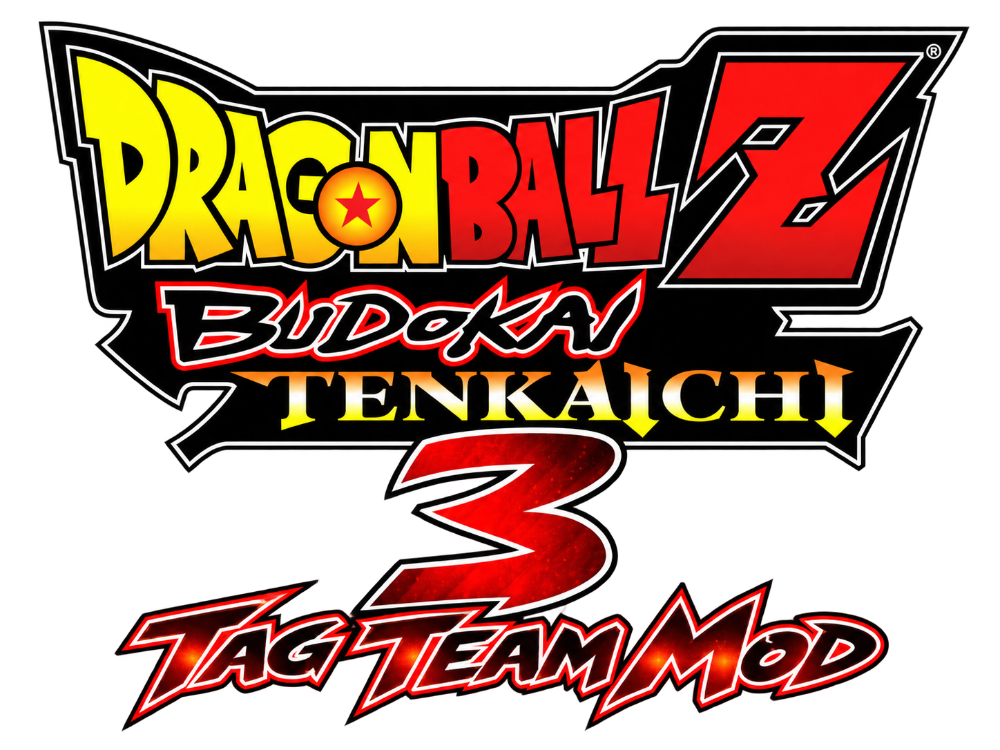

<p align="center">
  
</p>

# Budokai Tenkaichi 3 Tag Team Mod — Native PC

Fight together with up to ten fighters on the field at once. This native version
brings Tag Team battles to [Tenkaichi3Decomp](https://github.com/z3xox/Tenkaichi3Decomp),
with BT3 and BT4 support, local split-screen, and direct online rooms.

This is a development build. It runs on Windows and Linux without PCSX2.
You need your own game disc data; game assets, saves and binaries are not included here.

## What's here

- Team battles, Free For All, Modded Training, Gauntlet and World Tournament,
  reached through **Select → Modded Modes** in the game's main menu.
- Up to five fighters per team, uneven teams, CPU-only matches, and individual
  CPU difficulty. Character, outfit and equipment selection use the original menus.
- Two-, three- and four-player split-screen with the game's health and ki panels.
- Revivals, teammate takeover, directional targeting and lock-off, temporary and
  permanent fusions, shared fusion controls, and beam-clash assists.
- Expanded maps, giant scaling, configurable cinematic cameras, and HUD options.
- Online rooms for up to ten players and ten spectators, plus a persistent lobby
  where guests can practise while the host chooses the next mode.
- English and Spanish mod menus and settings.

For controls and settings, see [Native Tag Team](NATIVE_TAG_TEAM.md).
For hosting, joining and spectating, see [Online play](NATIVE_TAG_ONLINE.md).

## Supported discs

| Disc | Data folder | Windows launcher |
| --- | --- | --- |
| BT3 USA — SLUS-21678 | `gamedata` | `Play native prototype.cmd` |
| BT3 Europe/Australia — SLES-54945 | `gamedata-eu` | `Play native BT3 Europe.cmd` |
| BT3 Japan — SLPS-25815 | `gamedata-jp` | `Play native BT3 Japan.cmd` |
| BT4 B14 REV2 English | `gamedata-bt4` | `Play native BT4 prototype.cmd` |
| BT4 B14 REV2 Spanish | `gamedata-bt4-es` | `Play native BT4 Spanish.cmd` |

Import a supported disc into its matching folder:

```sh
python -m pip install pycdlib
python port/tools/import_native_disc.py "path/to/your-disc.iso" gamedata-eu
```

Choose an empty destination. Other disc revisions need a compatible profile;
renaming a disc does not make it compatible. Interface language and voice
language are separate, and available voices depend on the disc.

## Building and playing

Start with the [build instructions](docs/NATIVE_BUILD.md). The Windows launchers
expect the compiled executable at `port/build/bt3.exe`. Launch the matching disc,
then press **Select** (**Right Shift** on the default keyboard bindings) at the
main menu. **F1** opens controller bindings and graphics settings.

The source build currently uses the original USA executable's data tables.
Once built that way, it can run the supported regional and BT4 resource imports
listed above. Keep those locally extracted tables and disc assets out of Git.

Online connections are direct to the host's IPv4 address and TCP port. There is
no matchmaking service or relay for the modded rooms. Internet hosting may need
port forwarding, and everyone needs a matching build and game data. Windows and
Linux native builds currently use separate rooms. Multi-client
checks on one computer do not replace testing between separate PCs and networks.

## Contributing

Keep changes focused and include a way to reproduce gameplay fixes. Runtime
checks under `port/tests/` use your own extracted game data and isolated saves.
Do not commit disc data, save files, recordings, build output or credentials.

| Folder | Contents |
| --- | --- |
| `src/`, `include/` | Game code and native Tag Team mechanics |
| `port/src/` | Rendering, audio, input, online transport and platform support |
| `port/tools/` | Build tools and disc importers |
| `port/tests/` | Runtime and regression checks |
| `port/translations/` | Interface translations |
| `docs/` | Build and implementation notes |

## Credits and license

Based on [Tenkaichi3Decomp 0.1.37](https://github.com/z3xox/Tenkaichi3Decomp/tree/ec3c85a98cffd9cd22c22ac14cd62fb584d23664)
by z3xox and its contributors. The original history is retained. RexxColder
contributed the upstream OpenGL renderer and support for external stages and music.

The port and its modifications are under [AGPL-3.0-only](LICENSE). Earlier
MIT-licensed contributions retain their [MIT notice](LICENSE-MIT), and third-party
libraries retain their own licenses. The original game's code and assets belong
to their respective rights holders. This is an unofficial project and includes
no game disc assets.
