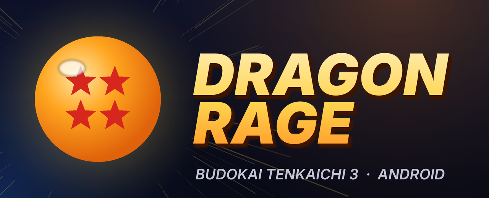
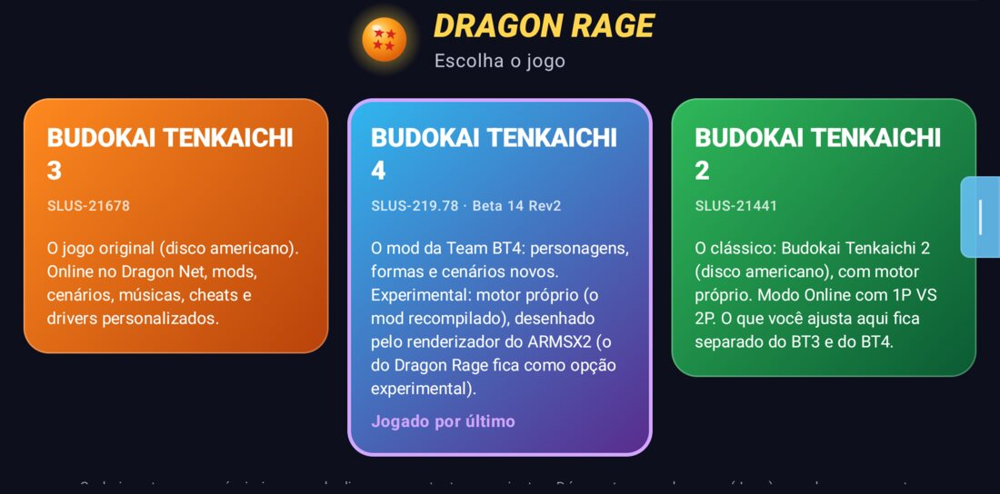
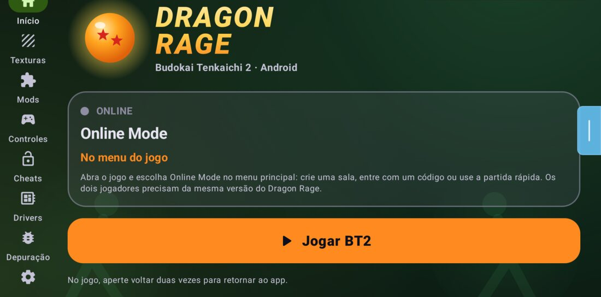
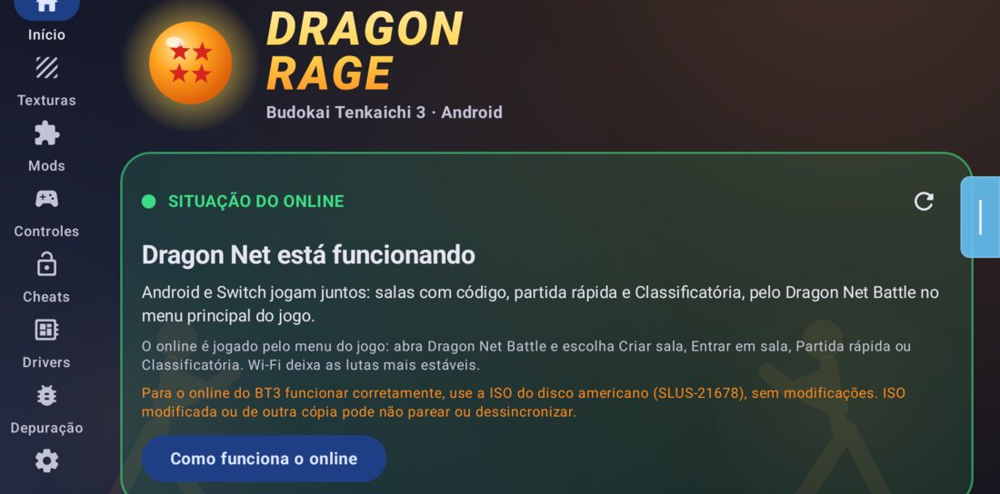
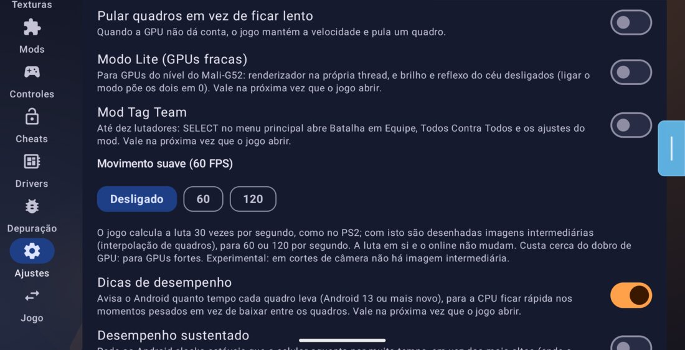
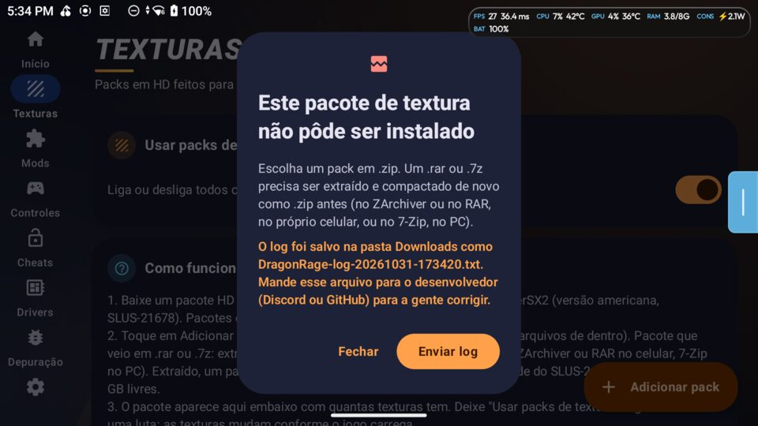
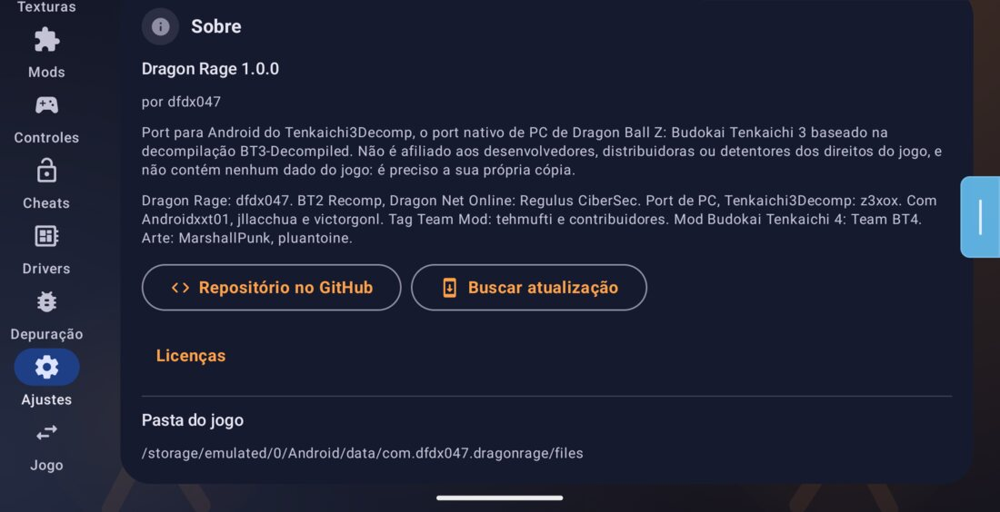
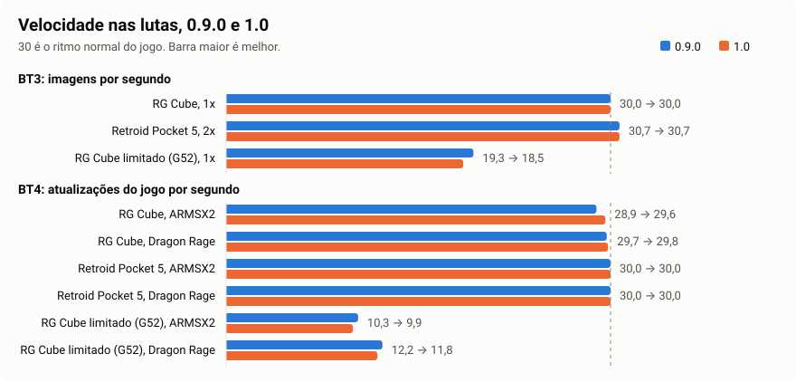
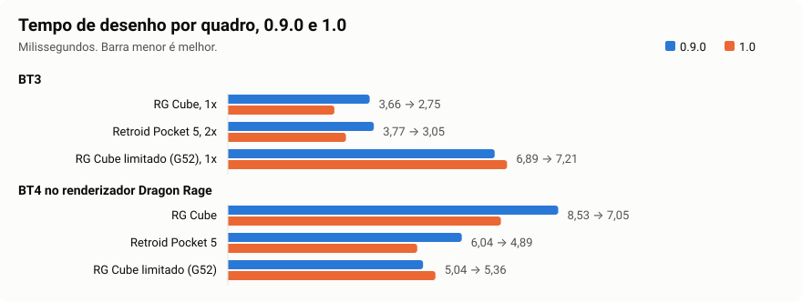

<p align="center">
  
</p>

<p align="center">
  <b>Dragon Ball Z: Budokai Tenkaichi 3, 4 e 2, rodando nativamente no Android.</b><br>
  Um port para Android do <a href="https://github.com/z3xox/Tenkaichi3Decomp">Tenkaichi3Decomp</a>, o port nativo para PC feito sobre a decompilação do BT3.
</p>

<p align="center">
  <a href="README.md">English</a> · <b>Português</b> · <a href="README.es.md">Español</a>
</p>

<p align="center">
  <a href="../../releases"></a>
  <a href="../../actions/workflows/android.yml"></a>
  
  <a href="https://discord.gg/6XXxT547Qx"></a>
  <a href="https://www.youtube.com/@DFDX47"></a>
  <a href="https://ko-fi.com/dfdx047"></a>
</p>

---

> [!IMPORTANT]
> **Status (1.0.0): três jogos no mesmo app, nativos em Android arm64.** O **Toque Pro** refaz o controle na tela para
> jogar sem controle físico, e uma **seleção de personagens nova** vem como opção. O **Budokai Tenkaichi 2** agora só pede
> a ISO, com online entre dois aparelhos. O **Budokai Tenkaichi 3** ganha o **Dragon Net Online**, com lobbies, espectadores
> e Classificatória, e o **Tag Team Mod** como opção, também online. O **Budokai Tenkaichi 4** tem o cenário distante
> corrigido no renderizador Dragon Rage e escolhe o renderizador pelo aparelho. Instala por cima da 0.9.0 e da 0.8.x, sem
> desinstalar. Em inglês, português e espanhol. Veja as [novidades](#novidades-da-10) e os [números](#números-09-e-10).

Este repositório **não contém nenhum dado do jogo**. Você precisa da sua própria cópia de cada jogo em `.iso`: **BT3
americano (SLUS-21678)**, **BT2 americano (SLUS-21441)** e **o mod BT4 da Team BT4, Beta 14 Rev2 (SLUS-219.78)**. O app lê
o arquivo no seu aparelho; nada é baixado nem enviado.

## O que é

O port para PC não é um emulador: é o próprio código do jogo, decompilado e compilado para PC, com uma nova camada de
renderização, som e controles por baixo. O Dragon Rage leva isso para o Android, junto com o BT4 e o BT2 recompilados:

| Parte | Onde | Estado |
|---|---|---|
| **App launcher** (Kotlin, Jetpack Compose, Material 3; inglês, português e espanhol) | [`android/`](android) | ✅ Pronto |
| **Budokai Tenkaichi 3** (o código C do port, compilado para arm64 como `libbt3.so`) | `src/`, `include/`, `port/` | ✅ Roda em Snapdragon, Mali, Xclipse e PowerVR; ajustado por nível de GPU |
| **Budokai Tenkaichi 4** (mod da Team BT4, recompilado como `libbt4.so`; renderizador ARMSX2 em `libbt4gsx.so` ou Dragon Rage) | `port/bt4/` | 🧪 Experimental |
| **Budokai Tenkaichi 2** (recompilado como `libbt2.so`) | `bt2/` | ✅ Luta, saves e online |

## Novidades da 1.0

<p align="center"></p>

Um app, três jogos. Cada um tem a própria ISO, os próprios saves, texturas e ajustes. A 1.0 instala por cima da 0.9.0 e
da 0.8.x, sem desinstalar: saves, ajustes, controles e jogos importados continuam.

### Toque Pro

<p align="center"></p>

O controle na tela refeito para jogar sem controle físico, principalmente no online. Em **Controles > Toque Pro**, com um guia
**Como funciona** dentro do app.

- **Perfis prontos**: Padrão, Online competitivo, Tranquilo e Clássico (0.9), mais o Canhoto, que espelha o layout.
- **Analógico dinâmico** (também Fixo e Flutuante), **zona morta**, **inclinação total** e **8 direções**.
- **Área de toque** em volta de cada botão, **arrastar entre todos os botões**, **toque alterna** para botões que você segura,
  **Meus perfis**, vibração.
- Vale no BT3, no Tag Team e no BT2. O layout que você já tinha salvo continua.

### Seleção de personagens nova

- Grade de lutadores, o lutador em 3D num pedestal e tela dividida em azul e vermelho, em todos os modos do BT3 e do Tag Team,
  offline e online.
- **Nova ou Clássica**: escolhida na primeira vez que você abre o BT3 na 1.0, e dá para trocar depois em Ajustes.

### Budokai Tenkaichi 2 só com a ISO

<p align="center"></p>

- **O motor vem dentro do app.** Não há mais pacote de motor para importar; se você tinha um, ele é apagado depois de um aviso.
- **A ISO fica onde está**: é lida no lugar, sem cópia. Só arquivos pequenos ficam na pasta do app.
- **ISO errada é recusada**, com uma mensagem que diz o que foi encontrado e em qual aba instalar.
- **Online Mode no menu do jogo**: crie uma sala, entre com um código ou use a partida rápida. Os dois aparelhos chegam sozinhos à seleção de personagens.

Testado entre um RG Cube e um Retroid Pocket 5: duas lutas (11.100 e 5.700 quadros) a 100% e 30 imagens por segundo nos dois, nenhuma dessincronia. Quem sai da partida avisa o outro, que volta ao Online Mode.

### Dragon Net Online

- **Telas novas no lugar do Dragon Net Battle**: partida rápida por região, Classificatória, entrar por código ou endereço, perfil.
- **Lobbies para até oito**: dois lutadores, seis espectadores, regras na página do lobby, revanches e torneios.
- **Menos pedidos aos servidores**: nada em segundo plano, espera crescente quando o servidor recusa, e a mensagem "Servidor ocupado, tente mais tarde" em vez de uma falha sem explicação.
- A música aleatória não separa mais os dois jogadores numa partida.

Testado: lobby entre os dois aparelhos com ping de 10 a 14 ms e nenhum rollback; 55 lutas seguidas em 580 s por conexão direta, com nenhuma dessincronia. A Classificatória não foi testada até o fim e os espectadores precisam de um terceiro aparelho que não tínhamos: veja os [problemas conhecidos](#problemas-conhecidos).

<p align="center"></p>

**Para o online do BT3 funcionar corretamente, use a ISO do disco americano (SLUS-21678), sem modificações.** Uma ISO modificada ou de outra cópia pode não parear ou dessincronizar. O app avisa isso na tela Início.

### Tag Team Mod

- Até 10 lutadores, com os modos e o Tag Team Online do mod de tehmufti e dos contribuidores, adaptados para o celular.
- **Tag Team Online**: salas por código com jogadores e espectadores; a sala inteira joga no ritmo do anfitrião.
- **Gráfico leve**: opcional, oferecido uma vez nos aparelhos mais fracos.
- **Vem desligado.** Ligue em Ajustes; depois, SELECT no menu principal abre os modos. Desligado, ele não aparece nas lutas normais.

<p align="center"></p>

Testado no Retroid Pocket 5: luta 5 contra 5 a 100% e cerca de 30 imagens por segundo. Os outros modos foram abertos, mas não jogados até o fim.

### Budokai Tenkaichi 4

- **Cenário distante corrigido**: as montanhas não saem mais em blocos de ruído colorido, e o desfoque de distância do jogo funciona.
- **Renderizador por aparelho**: aparelho fraco ou modo Lite usa o Dragon Rage; se o ARMSX2 ficar abaixo de 27 atualizações por segundo por 5 s numa luta, a próxima abertura usa o Dragon Rage. Sua escolha em Ajustes sempre vale.

### Correções a partir dos logs dos jogadores

Lemos 208 logs enviados por jogadores (485 execuções, 84 modelos de aparelho). Os 15 maiores problemas e o estado de cada um estão em [`docs/logs-1.0.md`](docs/logs-1.0.md).

<p align="center"></p>

- Menu font e letreiros não pedem mais dados do jogo que já estão na ISO.
- Sem aviso falso de pacote de textura com a pasta vazia.
- Um arquivo que falha ao ser lido: o jogo diz o motivo, tenta de novo e a luta continua.
- Disco modificado: tamanho negativo vira um aviso claro, não "sem memória".
- `.7z` e `.rar` são recusados com uma mensagem clara. Sem internet, verificar atualização não aparece mais como falha.
- O controle navega no launcher de novo, no RG Cube e no Retroid Pocket 5.

### Equipe e licenças no app

<p align="center"></p>

## Números: 0.9 e 1.0

Como medimos: a mesma luta gravada, com as mesmas entradas, nos mesmos aparelhos. **RG Cube** é um Mali-G57 MC4. **Retroid Pocket 5** é um Adreno 650. **RG Cube limitado** é o mesmo Cube preso a um chip como o Mali-G52 MC1 (1 núcleo de GPU a 512 MHz, só 4 núcleos pequenos de CPU a 1,85 GHz), para imitar um celular fraco; nesse perfil, 0.9.0 e 1.0 rodaram alternadas na mesma sessão, porque o calor muda o resultado.

<p align="center"></p>

**Budokai Tenkaichi 3** (0.9.0 → 1.0)

| Aparelho e perfil | Velocidade | Imagens/s | Trabalho por quadro (ms) | Desenho (ms) | Pior quadro (ms) | Passes | Cópias |
|---|---|---|---|---|---|---|---|
| RG Cube, 1x, Vulkan | 100% → 100% | 30,0 → 30,0 | 18,1 → 17,0 | 3,66 → 2,75 | 22,5 → 21,9 | 55,0 → 55,0 | 10,5 → 10,5 |
| Retroid Pocket 5, 2x, Vulkan | 100% → 100% | 30,7 → 30,7 | 13,8 → 13,4 | 3,77 → 3,05 | 42,8 → 11,5 | 45,4 → 45,4 | 3,7 → 3,7 |
| Retroid Pocket 5, 2x, OpenGL ES | 100% → 100% | 30,7 → 30,7 | 14,2 → 14,4 | | | | |
| RG Cube limitado, 1x | 100% → 100% | 19,3 → 18,5 | 30,9 → 31,0 | 6,89 → 7,21 | 64,1 → 83,2 | 48,5 → 49,4 | 6,6 → 7,4 |
| RG Cube limitado, 1x, Lite | 100% → 100% | 20,0 → 19,5 | 28,3 → 28,3 | 7,08 → 7,16 | | 47,9 → 46,4 | 6,5 → 6,9 |

Só na 1.0: RG Cube em OpenGL ES, 100%, 30,0 imagens/s, 18,6 ms. Retroid Pocket 5 com a CPU presa a 2 núcleos grandes e 4 pequenos, como um Snapdragon 480+ (a GPU fica inteira, porque esse aparelho não tem root): 100%, 30,7 imagens/s, 14,0 ms.

**Budokai Tenkaichi 4** (0.9.0 → 1.0)

| Aparelho e renderizador | Atualizações/s | Tempo do jogo por quadro (ms) | Desenho (ms) |
|---|---|---|---|
| RG Cube, ARMSX2 | 28,9 → 29,6 | 21,8 → 22,5 | |
| RG Cube, Dragon Rage | 29,7 → 29,8 | 21,7 → 21,4 | 8,53 → 7,05 |
| Retroid Pocket 5, ARMSX2 | 30,0 → 30,0 | 17,0 → 16,3 | |
| Retroid Pocket 5, Dragon Rage | 30,0 → 30,0 | 14,2 → 14,8 | 6,04 → 4,89 |
| RG Cube limitado, ARMSX2 | 10,3 → 9,9 | 61,9 → 70,5 | |
| RG Cube limitado, Dragon Rage | 12,2 → 11,8 | 55,5 → 60,2 | 5,04 → 5,36 |

Só na 1.0: OpenGL ES no renderizador Dragon Rage, RG Cube 29,6 e Retroid Pocket 5 30,0 atualizações/s. ARMSX2 a 60 fps no Retroid Pocket 5: 44 imagens/s com 34,7 atualizações/s (experimental, cai para 30 onde o aparelho não aguenta). Retroid Pocket 5 com a CPU limitada como acima: 30,0 atualizações/s nos dois renderizadores.

<p align="center"></p>

**Budokai Tenkaichi 2** (só na 1.0, já que antes ele pedia um pacote de motor à parte)

| Aparelho | Velocidade | Imagens/s | Quadro típico (ms) | Quadro mais lento (ms) | Travadas |
|---|---|---|---|---|---|
| RG Cube | 100% | 30 | 33,3 | 40,8 | 0 |
| Retroid Pocket 5 | 100% | 30 | 33,3 | 35,1 | 0 |

**Celular fraco ganha desempenho?** Em geral, não nesta versão, e preferimos dizer isso. No BT3 o perfil limitado ficou igual à 0.9.0 (de 18 a 20 imagens por segundo nas duas, a 100% de velocidade). No BT4 o jogo ainda não chega à velocidade total nesse perfil: de 8 a 10 imagens por segundo no ARMSX2 e de 10 a 11 no Dragon Rage. A mudança útil é o padrão, que agora cai sozinho no renderizador mais rápido. Nesse perfil, duas execuções da mesma versão diferem mais do que as duas versões entre si: no Dragon Rage, o tempo do jogo por quadro foi de 53 e 58 ms na 0.9.0 e de 53 e 68 ms na 1.0, alternadas na mesma sessão (a tabela traz a média). A linha do ARMSX2 vem de sessões separadas.

**A imagem é a mesma?** Comparamos 11 quadros fixos pixel a pixel contra a 0.9.0. No RG Cube, nenhum pixel diferente. No Retroid Pocket 5, 5 de 10 quadros da demonstração de abertura diferem (ver abaixo).

### Problemas conhecidos

- **Tag Team Online**: o menu de modos do anfitrião, depois de "Pronto" na sala, aparece sem as letras (visto no Retroid Pocket 5, em português). Quem entra por código chega à luta.
- **BT3 no Retroid Pocket 5 a 2x**: 5 de 10 quadros da demonstração de abertura diferem da 0.9.0. Causa ainda não encontrada; no RG Cube são 0 de 11.
- **BT2 online**: não há relay no processo da luta, então quem só conecta por relay pode não conseguir jogar.
- **Dessincronia no Dragon Net**: há correções, mas o problema aparece em logs de várias versões e continua aberto.
- **Classificatória**: às vezes fica em "Carregando perfil..." quando o servidor não responde.
- **Quem só joga BT2** não recebe o aviso de atualização do app.
- O cartão do online no launcher ainda diz "Dragon Net Battle".
- **Ainda sem teste**: importação limpa do BT3 e do BT4 nesta versão, Classificatória até o fim, espectadores, Tag Team Online em todos os modos, modo contra o PC.

## O app

<table>
<tr><td><b>Início</b></td><td>Escolha sua ISO. O app confere se é a versão americana (as mesmas verificações SHA-1 da instalação do PC; uma imagem traduzida ou modificada também instala, com um aviso) e copia os dados do jogo na estrutura que o motor espera. O botão <b>Jogar</b>, um <b>atalho de Jogar</b> para a tela inicial, <b>como funciona o online</b> (e o que fazer quando não conecta) e links para YouTube, Discord, Ko-fi e GitHub.</td></tr>
<tr><td><b>Texturas</b></td><td>Importe um pacote de texturas em <code>.zip</code>, baixe um direto pelo app (de uma lista mantida em <a href="android/texture-packs.json"><code>android/texture-packs.json</code></a>, ou de qualquer link direto para um <code>.zip</code>), ou copie a pasta dele para <code>textures/</code>. Pacotes feitos para o PCSX2 (<code>.dds</code> / <code>.png</code>) funcionam do jeito que estão: os arquivos <code>.dds</code> são descompactados para as GPUs de celular, que não leem DXT.</td></tr>
<tr><td><b>Mods</b></td><td>Mods de substituição de arquivos em <code>.zip</code> (com ordem de prioridade), estágios extras (<code>.unk</code>) e músicas extras (<code>.adx</code>, ou <code>.mp3</code>: convertidas pelo jogo), com o nome exibido nos menus do jogo editável.</td></tr>
<tr><td><b>Controles</b></td><td>O controle na tela: o visual <b>Dragão</b> (novo padrão: botões redondos escuros com ícones dourados, letras nas cores do Xbox, uma Esfera do Dragão de três estrelas no analógico), o visual <b>Vidro</b> da 0.5 ou o controle <b>clássico</b> de console; um layout feito para este jogo que alterna <b>sozinho</b> entre menus e lutas (modo história incluído), letras de PlayStation, Xbox ou Nintendo, editor de layout, macros, opacidade, tamanho, vibração, um botão só nos confrontos; <b>Toque Pro</b>: analógico dinâmico, zona morta, área de toque, arrastar, toque alterna, perfis e um guia.</td></tr>
<tr><td><b>Cheats</b></td><td><i>Desbloquear tudo</i>: todos os personagens, estágios, músicas e itens, e Zeni no máximo (a função de debug que os desenvolvedores deixaram no jogo).</td></tr>
<tr><td><b>Drivers</b></td><td>Drivers Vulkan personalizados para GPUs Adreno (Snapdragon) via AdrenoTools: as versões mais recentes de <b>Mr. Purple</b>, <b>StevenMXZ</b> e <b>K11MCH1</b> baixadas e instaladas com um toque, um <code>.zip</code> dos seus arquivos, escolher, remover.</td></tr>
<tr><td><b>Depuração</b></td><td>Seu aparelho e sua GPU com o <b>nível</b> dela, as configurações recomendadas para ele, o <b>log de desempenho</b> da última sessão (velocidade nas lutas e nos menus, quadros por segundo; ligado por padrão, sem custo perceptível) e <i>Exportar log</i> para relatar bugs.</td></tr>
<tr><td><b>Configurações</b></td><td>Renderizador (<b>Vulkan</b>, ou <b>OpenGL ES</b> para drivers em que o Vulkan falha), resolução interna de 1x a 8x em passos finos, filtro de tela (bilinear, nítido, FXAA, AMD FSR 1, Snapdragon GSR), formato da imagem, <b>orientação da tela</b> (paisagem, retrato, automática), <b>profundidade precisa</b>, <b>pular quadros</b> em vez de ficar lento, movimento suave (60 / 120), modo de apresentação, os efeitos do PS2, volumes, idioma, tema, Material You, a <b>seleção de personagens</b> (Nova ou Clássica), o <b>Mod Tag Team</b>.</td></tr>
<tr><td><b>No jogo</b></td><td>Um novo menu feito para dedos e controles, no visual do launcher e no seu idioma: Vídeo, Desempenho, Efeitos, Áudio, Interface (fontes, HUD, barras laterais), Controles, <b>Online</b> (como funciona, o que fazer quando falha), Trapaças, <b>Sair para o app</b>. Botão Voltar, START + SELECT ou o botão MENU na tela.</td></tr>
</table>

<p align="center"></p>

### Sua GPU, a 30 fps

Na primeira vez que abre com uma GPU conhecida, o app diz qual encontrou e sugere as configurações daquele nível
(você vê a lista e escolhe sim ou agora não; tudo continua podendo ser mudado):

| Nível | GPUs (exemplos) | Configurações sugeridas |
|---|---|---|
| Entrada | Mali-G31/G51/G52/G57, Mali-T, Adreno 3xx–5xx e 610/612, PowerVR GE/GM | 1x, movimento suave desligado, profundidade precisa desligada, pular quadros, os dois desfoques desligados |
| Fraca | Mali-G68/G71/G72, Adreno 613–620 e 702–712, Xclipse 530/540, PowerVR BXM | 1x, movimento suave desligado, profundidade precisa desligada, pular quadros, desfoque de movimento desligado |
| Intermediária | Mali-G76/G77/G78/G610/G615, Adreno 630–644 e série 720, Maleoon | 1.5x, movimento suave desligado, profundidade precisa desligada |
| Forte | Mali-G710/G715/G720/G725, Adreno 650–699 e série 730, Xclipse 920 | 2x |
| Topo de linha | Adreno 740 e mais novas (8 Gen 2, 8 Gen 3, 8 Elite), Immortalis, Mali-G925, Xclipse 940+ | 2x, movimento suave 60 |

### Instalação

Baixe o `DragonRage-<version>.apk` da [versão mais recente](../../releases/latest) e instale. Uma versão nova
instala por cima da antiga e mantém seus dados do jogo, configurações e saves; a 1.0 instala por cima da 0.9.0 e da
0.8.x, sem desinstalar. O app verifica o GitHub quando abre e oferece as versões novas com o changelog.

Para relatar um problema: *Depuração → Exportar log*, depois envie o arquivo `DragonRage-log-….txt` (no [Discord](https://discord.gg/6XXxT547Qx), por exemplo).

Para compilar você mesmo:

```sh
sh port/tools/android_toolchain.sh   # LLVM 21, the NDK's sysroot, SDL3 (once)
python3 port/tools/android.py        # the engine -> android/app/src/main/jniLibs (and its fonts and pictures -> assets)
python3 port/bt4/build_bt4.py --armsx2   # BT4, from your own disc (only with its files on this PC; nothing goes to git)
python3 bt2/android/build.py         # BT2, from your own disc (same)
cd android && ./gradlew assembleRelease   # needs JDK 17+ and the Android SDK (compileSdk 35)
```

As bibliotecas do BT4 e do BT2 são feitas a partir do programa do jogo: só vão dentro do APK compilado no seu PC, nunca para o git.

### Onde ficam os arquivos

Tudo fica em `Android/data/com.dfdx047.dragonrage/files/`, na **mesma estrutura que o port para PC usa ao lado do
executável**:

```
gamedata/            the disc's files (disc/SLUS_216.78, disc/BIN/, disc/DATA/ with the AFS archives, .installed)
gamedata/mods/       replaced files (rebuilt by the app from modlib/)
textures/            active texture packs (any depth)      textures_off/   packs switched off
stages/  songs/      extra stages and songs (maps.txt / songs.txt hold the menu names)
saves/               memory card
fonts/  tbo/ui/      the menu fonts and the online screens' pictures (copied from the app)
bt3_settings.txt     engine settings (name=number lines)
bt3_log.txt          the game's log of its last run
modlib/              the app's mod library
```

Chaves do Android em `bt3_settings.txt`: `dr_unlock_all`, `dr_renderer` (0 automático, 1 Vulkan, 2 OpenGL ES), `dr_orient`
(0 paisagem, 1 retrato, 2 automático), `dr_lang` (o idioma do menu dentro do jogo), `dr_gpu_tier` (o nível cujas
configurações foram sugeridas), `perf_log`, `frag_depth`. O controle na tela fica em `touch_controls.json`. Um arquivo
opcional `match_url.txt` (uma linha, `https://...`) aponta outro serviço de matchmaking.

## Roadmap

### Pronto
- [x] Launcher: instalação a partir da ISO com checksums, pacotes de texturas, mods, estágios e músicas extras, cheats,
      todas as configurações do motor, inglês / português / espanhol
- [x] Motor para arm64, carregado em qualquer ponto dos 4 GB baixos; o jogo inteiro em velocidade total em Snapdragon e
      Mali recentes
- [x] Toque: um controle feito para este jogo com layout automático de menu / luta, editor de layout, macros, três
      visuais (0.3–0.6)
- [x] Mali e GPUs fracas: Vulkan sem os recursos opcionais que faltam na Mali, shaders sem `discard`, render targets
      pequenos; renderizador OpenGL ES 3.2 com um anel de uniform buffers (0.5–0.6)
- [x] Modo online com códigos de sala e rollback, PC e Android juntos (0.4)
- [x] Pacotes de texturas HD (`.dds` descompactados na CPU), um limite de memória para o cache (0.5)
- [x] **0.6.0**: as novidades do port para PC (telas do Tenkaichi Budokai Online, fontes de menu e de batalha, painéis
      de lutadores nas laterais, profundidade precisa, sombras planas com stencil, músicas em MP3, Lutar de Novo no modo
      história), um novo menu dentro do jogo para toque, níveis de GPU com configurações recomendadas, download de
      drivers, página de Depuração, orientação, espanhol, o controle Dragão, o layout automático do modo história
      corrigido
- [x] **0.7.0**: a 0.1.36 do port de PC (online aceito de novo), aviso da situação do online no launcher, página
      Dragon Net Battle para toque, pacotes de textura guardados em ASTC, verificação de ISOs modificadas ou incompletas e um aviso explicando por que o
      jogo fechou
- [x] **0.7.1**: framebuffer fetch desligado de novo (blocos pretos e GPU travada em Mali-G52 com OpenGL ES), aviso
      ao escolher OpenGL ES numa Mali
- [x] **0.7.2**: pacotes de textura em ASTC desligados por padrão (experimental): as lutas voltam ao código de motor
      da 0.6.0
- [x] **0.7.3**: a 0.1.37 do port de PC (online aceito de novo, mensagens no início da partida, blending da Solar Flare,
      catálogos de texto)
- [x] **0.8.0**: **Dragon Net**: online com o port de Nintendo Switch (DBT-NX) num serviço próprio (salas, partida
      rápida, Classificatória com Elo, chat geral, jogadores online), sem depender das versões do port de PC; nova tela
      Dragon Net Battle; online contra PC mantido como opção (`port/dragonnet`, `docs/DRAGON_NET.md`)
- [x] **0.8.1**: Dragon Net em três servidores (um reserva e a Classificatória à parte), menos pedidos a eles
- [x] **0.9.0**: a 0.1.38.7 do port de PC; Budokai Tenkaichi 4 com o renderizador do ARMSX2 por padrão (shaders
      compilados de antemão), lutas a 60 fps (experimental, volta para 30 onde o aparelho não aguenta); o online pausa
      no HTTP 429 e avisa que o servidor está ocupado; o controle clássico cabe em telas quadradas; medida num RG Cube
      e num Retroid Pocket 5 (`docs/release-0.9.0.md`)
- [x] **1.0.0**: Toque Pro; a seleção de personagens nova (Nova ou Clássica); BT2 só com a ISO e BT2 online; Dragon Net
      Online com lobbies, espectadores e Classificatória (PC 0.1.39); Tag Team Mod como opção, com Tag Team Online; instala
      por cima da 0.9.0 e da 0.8.x; cenário distante do BT4 corrigido e renderizador por aparelho; correções a partir de 208 logs de
      jogadores; menos pedidos aos servidores; equipe e licenças no app; mapa de mudanças em `docs/changes/`
      (`docs/release-1.0.md`)

### Próximos passos
- [ ] Mais GPUs medidas para os níveis (mande seu log!)
- [ ] Imagem: filtragem anisotrópica, SMAA, mais pós-processamento
- [ ] Pausar o jogo enquanto o app estiver em segundo plano

## Estrutura do repositório

| Caminho | Conteúdo |
|---|---|
| `android/` | **Dragon Rage**, o app Android (projeto Gradle) |
| `src/`, `include/` | O código do jogo, vindo da decompilação; as mudanças do PC ficam dentro de `#ifdef PORT` |
| `port/` | O port para PC: camada de plataforma, renderizador, som, controles, ferramentas de build |
| `bt2/` | O Budokai Tenkaichi 2 recompilado: runtime, plugin online, build para Android |
| `port/bt4/` | O Budokai Tenkaichi 4 recompilado: ganchos, shim e build |
| `docs/` | Notas sobre o jogo e sobre o port para PC; [`docs/changes/`](docs/changes) é o mapa do que mudou, por área e por arquivo |

## Equipe e créditos

- **[Tenkaichi3Decomp](https://github.com/z3xox/Tenkaichi3Decomp)**, de **z3xox** e colaboradores: o port nativo de PC
  em que isto se baseia, e a decompilação por baixo dele.
- **Dragon Rage** (app Android e port): [dfdx047](https://github.com/dfdx047) ·
  [YouTube](https://www.youtube.com/@DFDX47) · [Discord](https://discord.gg/6XXxT547Qx) · [Ko-fi](https://ko-fi.com/dfdx047)
- **Regulus CiberSec**: BT2 Recomp no Android, Dragon Net Online, Tag Team no Android e online, a seleção de personagens
  nova, espectadores e lobbies.
- **Androidxxt01**, **jllacchua**, **victorgonl**: contribuições ao port de PC e ao app.
- **tehmufti e os colaboradores do Tag Team Mod**: o Tag Team Mod.
- **Team BT4**: o mod Budokai Tenkaichi 4.
- Arte: **MarshallPunk** (o locutor), **pluantoine** (os botões, CC BY 4.0).
- Drivers de GPU de [Mr. Purple](https://github.com/MrPurple666/purple-turnip), [StevenMXZ](https://github.com/StevenMXZ/Adreno-Tools-Drivers)
  e [K11MCH1](https://github.com/K11MCH1/AdrenoToolsDrivers), carregados com [libadrenotools](https://github.com/bylaws/libadrenotools) (BSD-2-Clause).
- [AMD FidelityFX Super Resolution 1](https://github.com/GPUOpen-Effects/FidelityFX-FSR) (MIT),
  [Snapdragon Game Super Resolution](https://github.com/SnapdragonStudios/snapdragon-gsr) (BSD-3-Clause), [SDL3](https://libsdl.org) (zlib), [Apache Commons Compress](https://commons.apache.org/proper/commons-compress/) (Apache-2.0),
  [Dear ImGui](https://github.com/ocornut/imgui) (MIT), as fontes em `port/third_party/fonts` (cada uma com sua licença).
- Feito com a ajuda de IA.

## Licença

O código próprio do port para PC (`port/`, exceto `port/third_party/`) está sob a [GNU Affero General Public License,
versão 3](LICENSE) a partir do commit `06e4671` do port para PC (2026-10-14); o código anterior a ele continua disponível
sob a [licença MIT](LICENSE-MIT). O Dragon Rage é construído sobre esse código, então o app como um todo é distribuído
sob a AGPL-3.0, com o código-fonte completo aqui; os arquivos próprios do app Android (`android/`) também são oferecidos
sob MIT. As bibliotecas em `port/third_party/` e os shaders de FSR / GSR mantêm suas próprias licenças (nos arquivos ao
lado deles). O código do jogo em `src/` e `include/` vem da decompilação e pertence aos detentores dos direitos do jogo.

## Aviso legal

Este projeto não tem vínculo com os desenvolvedores, publicadoras ou detentores dos direitos do jogo, nem é endossado
por eles. Ele existe para preservação, estudo e interoperabilidade, e não distribui nenhum asset do jogo. Dragon Ball e
todos os nomes relacionados pertencem aos seus donos. Você precisa da sua própria cópia do jogo, obtida legalmente.
